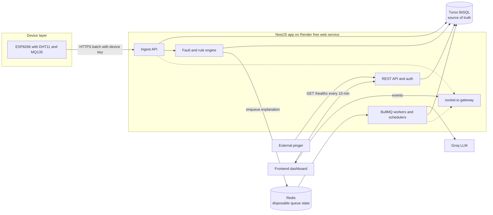
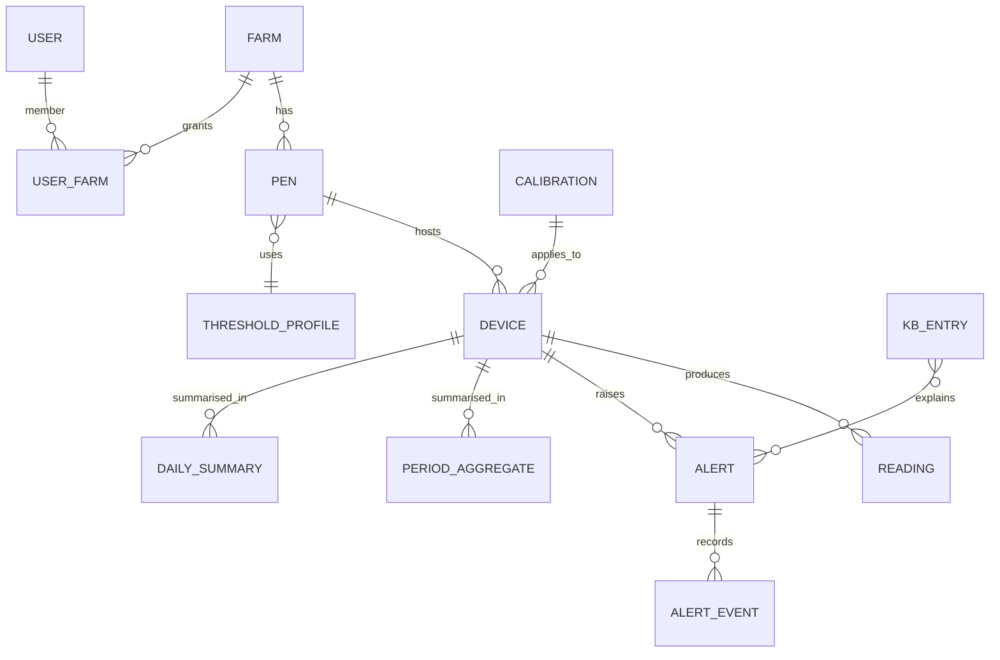
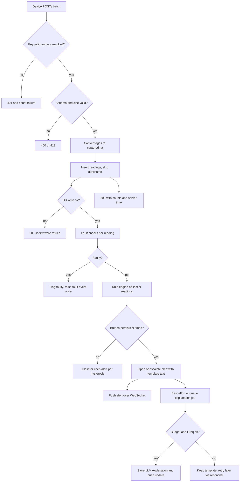
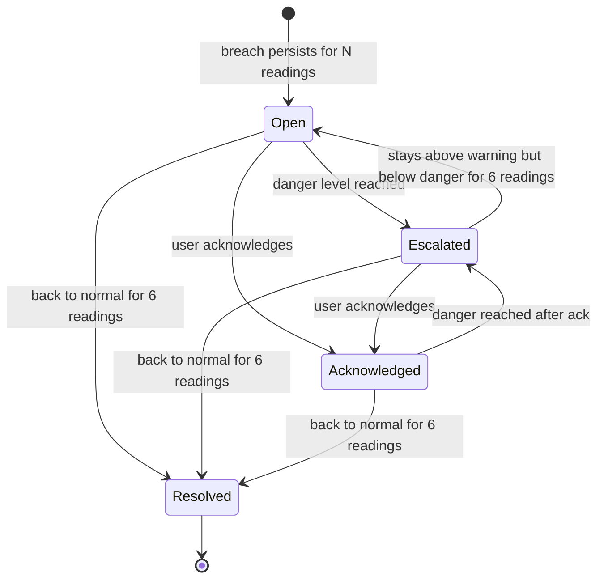
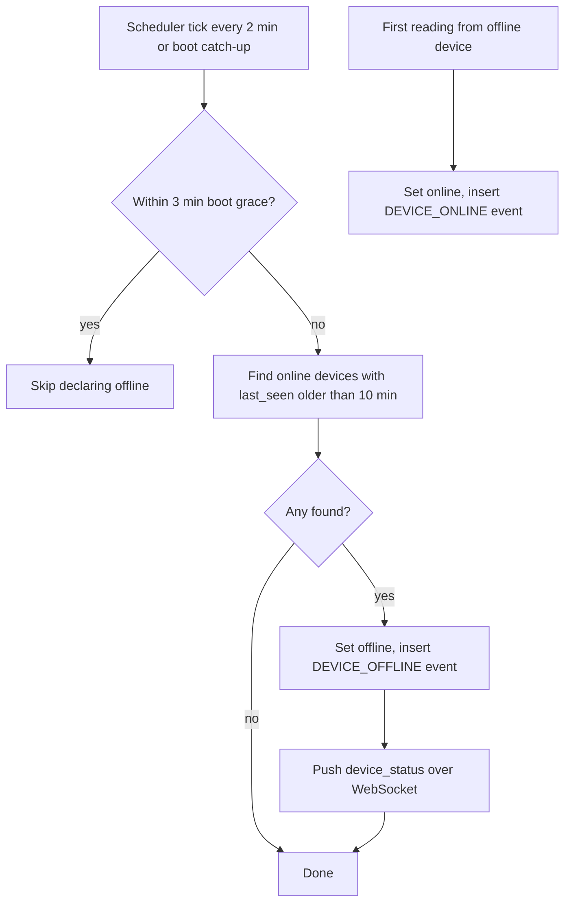
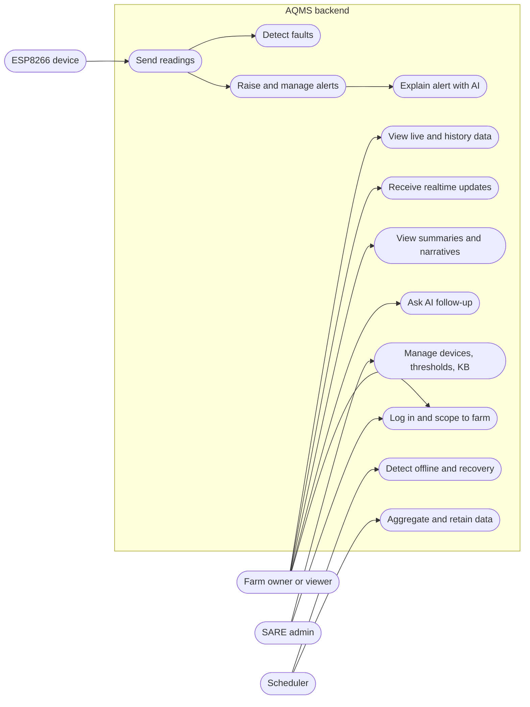

# AQMS Backend: PRD

Status: Draft | Owner: Prosper (Backend & AI Team, SARE) | Last updated: 2026-10-16 | Version: 0.1

Scope: the backend and AI layer of the Air Quality Monitoring System (AQMS), as defined in SARE's AQMS Project Requirement Document (sections 6 and 9) and the earlier "AQMS Backend Architecture Plan". Frontend, firmware, PCB and casing are out of scope except where this backend depends on them.

How to read this: every fact about the outside world carries a status in the Assumption Ledger (section 5.1): Verified, Contradicted, or Unverified. Sections most likely to change: 2 (hosting decisions at go-live), 3.2 and 3.4 (threshold values, pending SARE's poultry advisor), 3.5 (ingest contract, pending the firmware workshop), 5.3 (open questions).

---

## 1. Overview

### 1.1 Problem and opportunity

Poultry pens build up ammonia, heat and moisture, and farmers often notice only after birds are affected. Guidance cited by the Ontario ag ministry puts the ammonia maximum at 25 ppm, with lung surface damage above 10 ppm and more respiratory problems above 20 ppm; the EU welfare directive uses 20 ppm as a threshold; recommended relative humidity is roughly 50 to 70%, and wet litter drives ammonia up (sources in section 6).

AQMS is a wall-mounted ESP8266 device (DHT11 temperature and humidity, MQ135 gas sensor) that posts readings to a backend. The backend must store them, judge them against safe ranges, raise alerts, explain alerts in plain language (AI), summarize trends, and feed a real-time dashboard. This PRD specifies that backend.

### 1.2 Target audience

| Segment | Pain | Current workaround | Evidence |
|---|---|---|---|
| Farm owner or pen operator (end user of the dashboard) | Cannot see air conditions continuously; ammonia is hard to judge by smell | Walk the pen; smell | Ammonia is typically not noticed by smell until 50 to 60 ppm (UGA broiler tip). Farmer interviews not done: Unverified |
| SARE team (builders, demo audience) | Needs a working end-to-end system on a zero-budget stack | Free tiers | SARE PRD; stack choice made by the user on 2026-10-16 |
| SARE admin (provisioning, support) | Needs to create devices, keys, farms, thresholds without touching the database | None yet | Derived from PRD section 6.2 |

### 1.3 Market and competitors

Not applicable to this document. Product positioning belongs to SARE's product PRD. This PRD only defines the backend.

### 1.4 Positioning and ship plan

- **MVP (v1):** device ingest with authentication, storage, fault detection, threshold alerts with a proper lifecycle, offline detection, AI explanation with graceful fallback, period and daily summaries, REST plus WebSocket for the dashboard.
- **Dev profile (now):** all free tiers: Render free web service, Turso free, a free Redis for BullMQ, Groq free. Cost $0. Accepted limits are in section 2.
- **Go-live profile (later):** hosting target to be chosen (OQ-1). The code is built to move: repository layer over the DB, Redis treated as disposable, no host-specific features.
- **First vertical slice:** simulator -> ingest -> store -> rule -> alert row -> `GET /devices/latest`. This proves the riskiest path before AI and summaries.

### 1.5 Groundwork (settle before or during M0)

- Accounts: Render, Turso, a Redis host, Groq, GitHub (repo and CI). Owner: backend team.
- **Firmware contract workshop** with the hardware team (batching, retry rules, boot id and sequence number, time sync, TLS approach, raw ADC). Without it the ingest contract is a guess. See OQ-6, OQ-7.
- **Threshold source:** SARE needs a named poultry advisor to confirm alert thresholds and whether they vary by bird age (OQ-3). The values in the source architecture doc do not match published guidance (section 3.4).
- **Sensor reality check:** MQ135 is not an ammonia sensor in the strict sense. The datasheet lists NH3 10 to 300 ppm among several cross-sensitive gases, needs 24 hours or more of preheat and requires calibration. PPM numbers will be estimates; the product must label them so (OQ-8).
- **Data protection:** farm user accounts hold personal data. Whether Nigerian data protection law imposes duties on SARE here has not been checked (OQ-11).

### 1.6 Goals, non-goals, success metrics

**Goals**
- G1: No accepted reading is lost to a backend restart.
- G2: A breach shows on the dashboard within seconds, with a useful explanation soon after, and never blocks on the AI provider.
- G3: Offline and faulty devices are surfaced, not silently shown as "normal".
- G4: The whole system runs at $0 in dev and can move to a paid host without a rewrite.

**Non-goals (v1)**
- No firmware, frontend, PCB or casing work.
- No actuator control (fans, heaters) even though SARE's overview lists "Automation". Parked as OQ-13.
- No SMS, WhatsApp or push delivery in v1; a channel interface exists, channels are OQ-4.
- No multi-region, no high availability, no SLA on the free profile.
- No ML model training; AI means LLM explanation and narrative only.

| Metric | Baseline | Target | Timeframe | How measured |
|---|---|---|---|---|
| Reading durability | none | 100% of readings acknowledged with 2xx are in the DB after a forced kill | M1 done | kill-9 test (A-M1-1) |
| Reading to dashboard push latency (p95, service awake) | none | <= 2 s | M4 done | simulator timestamps vs WS receive |
| Breach to alert row (p95) | none | <= 1 s after commit | M2 done | integration test |
| Explanation availability | none | 100% of alerts show a template explanation immediately; LLM text for >= 90% within 60 s while within budget | M6 done | alert table, `explanation_source` |
| Offline detection (service awake) | none | <= 12 min after last reading (10 min threshold + 2 min sweep) | M5 done | simulator stop test |
| Free-tier headroom | none | Turso writes <= 80% of 10M/month at pilot device count; LLM tokens <= 80% of daily free limit | continuous | write meter, `llm_usage_daily` |

Primary metric: durability plus alert latency (this is a safety-adjacent product). Guardrails: false-offline alerts per device per week <= 1 (while the service is awake); LLM-caused alert delay = 0 (AI is never on the alert path).

---

## 2. Tech Stack and Tools (approved by user: yes, 2026-10-16)

Decisions from the user: dev profile on Render, Turso and a free Redis; BullMQ for jobs; tag-based knowledge lookup (no vector DB); offline detection via BullMQ schedulers. The Heroku student credit is not available to the user, so Heroku-based plans in the source doc are dropped. Pinecone was named by the user but is not needed once retrieval is tag-based; it is dropped (OQ-14 to confirm).

### 2.1 Core stack

| Layer | Choice | Why | Alternatives considered |
|---|---|---|---|
| Runtime and framework | Node.js, NestJS, TypeScript | Source doc already assumes it; modules, guards and DI suit the auth, scoping and worker split | Fastify only (less structure) |
| HTTP and realtime | REST under `/api/v1`, socket.io for live events | Doc choice; socket.io works on a single instance; Render free wakes on a new WebSocket connection | SSE (simpler, but doc and frontend assume socket.io) |
| Database (dev) | Turso (libSQL) free | User decision; zero cost | Neon free Postgres (rejected: see DR-2), Render free Postgres (expires in 30 days) |
| Database (go-live) | Postgres (host TBD, OQ-1) | Same schema concept, more write headroom, `pgvector` available if ever needed | Stay on Turso paid |
| DB access | Repository layer plus Drizzle ORM (separate sqlite/turso and postgres schema files) | Drizzle supports both dialects; keeps SQL out of services | Kysely, raw SQL |
| Jobs and schedules | BullMQ with job schedulers | User decision; retries, backoff, rate limiting, cron with timezone | pg-boss (Postgres queue, no Redis; viable if Redis proves painful) |
| Redis (dev) | Render Key Value free (primary), Redis Cloud free (fallback) | Same-region private network; data is disposable by design (DR-4) | Upstash free (rejected: 500K commands/month vs BullMQ polling) |
| LLM | Groq: `llama-3.3-70b-versatile` for alert explanations, `llama-3.1-8b-instant` for narratives and overflow | Free, fast; split by token budget (DR-6) | Gemini free tier (prompts may be used by Google on the free tier per one secondary source: Unverified) |
| Knowledge retrieval | Tag-based table in the main DB | Alerts are structured; no embeddings or vector service needed | pgvector, Pinecone (dropped) |
| Hosting (dev) | Render free web service (one service) | User decision | Heroku (unavailable), Railway (usage-billed) |
| Keep-alive | External pinger calling `GET /healthz` every <= 10 min | Render sleeps free services after 15 idle minutes | None free and officially supported |

### 2.2 External services and integrations

Checked 2026-10-16.

| Service | Purpose | Pricing | Limits and quotas | Caveats | Source |
|---|---|---|---|---|---|
| Render free web service | Runs NestJS app | $0 | Spins down after 15 min without inbound traffic; wakes on HTTP request or new WebSocket connection, about 1 min; 750 free instance hours per workspace per month; may restart at any time; local disk is ephemeral | One always-on service uses about 744 h, so a second free service will not fit. No official keep-alive; pinging is a workaround | Render docs |
| Render Key Value free | BullMQ backend | $0 | One free instance per workspace; no disk persistence; may restart at any time and lose data. 25 MB size from secondary sources: Unverified | Fine only because the DB is the source of truth (DR-4). Eviction policy must be `noeviction` for BullMQ; confirm it is settable (spike S2) | Render docs, BullMQ docs |
| Redis Cloud free (fallback) | BullMQ backend | $0 | 30 MB, 30 connections, 100 ops/sec; deleted after 14 days with no activity; no backups | Cross-provider latency; BullMQ polling counts as activity | Redis docs, Redis support |
| Turso free | Primary DB (dev) | $0 | 10M rows written and 500M rows read per month; queries fail with a BLOCKED error when a quota is exceeded | Writes include updates; index and delete accounting not documented (spike S1). Developer plan is $5.99 monthly or $4.99 billed yearly with 25M writes and $1 per extra million, not unlimited | Turso pricing, Turso billing docs |
| Groq free | Explanations, narratives, chat | $0 | `llama-3.3-70b-versatile`: 30 RPM, 1,000 RPD, 12K TPM, 100K TPD. `llama-3.1-8b-instant` (secondary source): 30 RPM, 14,400 RPD, 6K TPM, 500K TPD. Limits are per organization, not per key | The source doc's "14,400 req/day" applies to the 8B model only. Token limits, not request limits, are the constraint (DR-6) | Groq docs, secondary guides |
| External pinger | Keep Render awake, dead-man check | $0 | GitHub Actions schedule (can run late), cron-job.org or UptimeRobot. One source says UptimeRobot's free plan bars commercial use since Nov 2024: Unverified | Acceptable for dev and demo only | Render community, Odown, DEV |

### 2.3 Decision records

- **DR-1 Dev hosting.** Context: Heroku credit unavailable. Options: Render free, Railway, Fly, VPS. Decision: Render free, as chosen by the user. Consequences: sleeping and restarts are normal events, so every design choice below assumes the process can vanish at any time and that "all devices offline" can put the service to sleep. Exit path: Dockerizable Node app, no Render-specific APIs, `render.yaml` only for deploy.
- **DR-2 Database.** Context: ingest is write-heavy (see 2.4). Options: (a) Turso free, (b) Neon free Postgres, (c) Render free Postgres. Decision: Turso for dev. Neon free gives 100 CU-hours per project; at an assumed 0.25 CU minimum, 24/7 compute is about 186 CU-hours, so continuous 10-second ingest would exhaust it (Unverified: minimum CU not confirmed). Render free Postgres expires after 30 days. Consequences: dialect change at go-live. Mitigation: repository interfaces, portable schema (integer epoch milliseconds for time, text ids, no JSON operators in queries), both dialects in CI from M0.
- **DR-3 Redis host.** Options: Render Key Value free, Redis Cloud free, Upstash free. Decision: Render Key Value first. Upstash's free tier allows 500K commands per month and BullMQ polls constantly (users report thousands of requests per hour when idle; anecdotal), so it would run out within days. Redis Cloud is the fallback if `noeviction` cannot be set on Render's free instance.
- **DR-4 Postgres-style source of truth, disposable Redis.** Decision: readings and alerts are written to the DB before anything touches Redis. An alert is created with `explanation_status = pending`; the queue is only an accelerator. A reconciler re-enqueues anything pending on boot and every 5 minutes. Job schedulers are re-registered idempotently on every boot. Consequences: losing all of Redis causes delay, never data loss. Ingest has zero dependency on Redis.
- **DR-5 Retrieval.** Decision: tag-based KB lookup (user choice). The KB is a table keyed by sensor, level and composite condition; the best matches by specificity go into the prompt. Consequences: no embedding quota, no pinned embedding model, no vector DB. Revisit only if the KB grows past a few hundred entries or free-text matching is needed (pgvector in the same Postgres is the path).
- **DR-6 LLM routing and budget.** At roughly 1,500 tokens per explanation (assumption), the 70B free budget of 100K tokens per day is about 66 explanations. A daily narrative per device would consume most of it by itself at pilot scale (33 devices x about 2K tokens = 66K). Decision: explanations use 70B; narratives and chat overflow use 8B; a per-day ledger (`llm_usage_daily`) routes 70B -> 8B -> KB template. AI is never on the alert path. Alerts are throttled to one LLM call per (device, sensor, level) per 30 minutes.
- **DR-7 Ingest protocol.** Decision: batch endpoint (up to 60 readings), per-reading age offsets instead of device clock, `boot_id` + `seq` for idempotency, raw MQ135 ADC from the device with NH3 estimated server-side per calibration, HTTPS only. Why: ESP8266 has no battery-backed clock, TLS handshakes are slow on it (one report: 20 s with a full certificate store versus 2 s with a pinned fingerprint), Render cold starts drop requests for about a minute, and calibration must be changeable without reflashing. Firmware retries only on network errors, 5xx and 429, never on other 4xx.
- **DR-8 Scheduling and offline detection.** Decision: BullMQ job schedulers (user choice) for offline sweep, aggregates and retention, plus (a) an external pinger so the process stays awake, and (b) a catch-up pass on every boot. Why: an in-process scheduler cannot fire while the service is asleep, which happens exactly when every device is offline (for example a farm power cut). Consequence: offline alerts can be late by up to the pinger interval; with no pinger they fire on the next wake.

### 2.4 Estimated running cost and capacity

**Dev profile: $0 per month** (all free tiers above).

**Turso write budget per device per month** (10 s interval = 8,640 readings per day, 259,200 per month):

| Component | Writes per device-month | Counted? |
|---|---|---|
| Reading inserts | 259,200 | Yes (inserts counted) |
| Index entry per insert | +259,200 | Unverified (a comparable product counts it) |
| Retention deletes (steady state) | +259,200 | Unverified |
| `last_seen` updates, throttled to 1 per minute | 43,200 | Yes (updates counted) |
| Aggregates, alerts, events | < 5,000 | Yes |

Free capacity = 10,000,000 / per-device writes: about **33 devices** if neither index entries nor deletes count, about **12 devices** if both count. The source doc's "38 devices" ignored `last_seen` updates, indexes and deletes. Spike S1 measures the real figure. Levers if short: lower sample rate to 30 s (3x capacity), shorter raw retention, Turso Developer plan ($4.99 to $5.99 per month, 25M writes).

**Go-live profile (indicative, not committed):** Render paid web service from $7 per month, Render Postgres from $6 per month, paid Key Value (secondary sources disagree, about $7 to $10) = roughly $20 to $25 per month at pilot scale. Verify at go-live (OQ-1). Groq paid-tier pricing must be fetched at that time.

---

## 3. Architecture

### 3.1 Functional requirements

Priority: M = Must, S = Should, C = Could, W = Won't (v1).

| ID | Requirement | Pri | Acceptance criteria |
|---|---|---|---|
| FR-1 | Admin can register a device, receive its API key once, rotate it, and revoke it | M | Key shown once; only a hash is stored; a revoked key gets 401 on the next request |
| FR-2 | `POST /api/v1/ingest` accepts a batch of 1 to 60 readings authenticated by device key | M | Valid batch returns 200 with per-batch counts; bad key 401; oversized 413 |
| FR-3 | Ingest is idempotent per (device, boot_id, seq) | M | Replaying the same batch 10 times stores each reading once |
| FR-4 | Each reading's `captured_at` = server receive time minus its `age_s`; device clock is never trusted; `time_quality` is recorded | M | Reading with `age_s` > 24 h or negative is rejected with a reason |
| FR-5 | Store raw MQ135 ADC; compute the NH3 estimate server-side from a versioned calibration | M | Changing calibration changes new estimates without a firmware change; each row records `calib_version` |
| FR-6 | Detect faulty readings (NaN or checksum error, out of sensor range, stuck value, impossible jump, ADC saturated) and store them flagged `faulty` | M | Faulty rows are excluded from rules, aggregates and charts; a `SENSOR_FAULT` event is raised once per fault episode |
| FR-7 | Evaluate thresholds per reading from the pen's threshold profile, with debounce | M | N consecutive breaches (default 3) open an alert; values come from the profile, not code |
| FR-8 | Alerts have a lifecycle: open, acknowledged, resolved; one open alert per (device, sensor); escalation warning to danger; hysteresis on resolve | M | Sustained breach for 24 h produces 1 open alert (plus at most 1 escalation), not 8,640 |
| FR-9 | Every alert gets an immediate template explanation, then an LLM explanation filled asynchronously | M | `explanation_source` is `template` at creation and later `llm`; alert visible before any LLM call |
| FR-10 | LLM calls pass through a budget router (70B, then 8B, then template) with throttling | M | When Groq returns 429 or the daily budget is spent, the alert keeps its template and is retried later without error to the user |
| FR-11 | Knowledge base of tagged entries (sensor, level, combination), with a seed set and admin CRUD | M (seed), S (CRUD) | Query for NH3 danger with high humidity returns the combined entry before generic NH3 entries |
| FR-12 | Detect device offline (default 10 min without a reading) and recovery; raise `DEVICE_OFFLINE` and `DEVICE_ONLINE` events | M | Simulator stopped: event within 12 min while service is awake; first reading afterwards flips status back |
| FR-13 | Device status API: online, offline, faulty, last_seen, firmware version | M | Matches DB state within one sweep interval |
| FR-14 | Latest reading per device and paginated history with date range filter | M | Cursor pagination, max 1,000 rows per page, filter by `from` and `to` |
| FR-15 | Realtime events over WebSocket: `reading`, `alert`, `device_status` | M | Client receives only events for farms it is authorised for |
| FR-16 | Period aggregates (morning 06 to 12, afternoon 12 to 18, evening 18 to 22, night 22 to 06) in the farm's time zone | M | Night period belongs to the date it started; periods with no data are marked, not zero |
| FR-17 | Daily summary computed from raw rows weighted by sample count, plus an AI narrative from the last 3 to 7 daily summaries | M | Narrative job failure does not block the numeric summary |
| FR-18 | Monthly and yearly summaries from daily summaries, with narrative | S | Month with a 3-day outage reports coverage percent |
| FR-19 | AI follow-up chat on an alert or summary, stateless, last 3 to 5 turns in the request | S | Cannot return data of another farm; refuses off-topic requests |
| FR-20 | Responses honour a `lang` parameter from an allowed list; fall back to English | S | Unsupported value returns 400 with the supported list |
| FR-21 | User authentication, roles (admin, owner, viewer) and farm scoping on every read | M | User A cannot read farm B by any endpoint or WebSocket room |
| FR-22 | Retention job deletes raw readings older than the configured days (default 90) in small batches; summaries are kept | M | Job never holds a long transaction; batch size configurable |
| FR-23 | Admin can manage threshold profiles, pens, calibrations and KB entries | S | Changes are audit-logged and take effect within 1 minute |
| FR-24 | `GET /healthz` (no DB, no external calls) and `GET /readyz` (DB and Redis state) | M | `/healthz` p95 under 50 ms |
| FR-25 | OpenAPI documentation published from code | M | CI fails if the spec is out of date |
| FR-26 | Ingest response returns `server_time_ms` and `config_version` so firmware can sync time and interval | C | Firmware can set its sample interval from the response |
| FR-27 | Notification channel interface (webhook, email) behind a port | C | Port exists; no channel is wired in v1 |
| FR-28 | Audit log of admin and security-relevant actions | S | Key rotation, revoke, threshold change, and role change are recorded with actor |
| FR-29 | Device simulator and seed scripts (normal, breach, fault, offline, burst, replay) | M | One command runs a scenario against any environment |
| FR-30 | SMS, WhatsApp, push, actuator control | W | Out of scope v1 |

### 3.2 Non-functional requirements

| ID | Category | Requirement | How verified |
|---|---|---|---|
| NFR-1 | Durability | A reading acknowledged with 2xx survives `kill -9` of the process and loss of all Redis data | Chaos test A-M1-1, A-M5-3 |
| NFR-2 | Latency | Ingest p95 <= 300 ms for a 6-reading batch while the service is awake (excluding Turso network outliers above p99) | Load test, 40 simulated devices |
| NFR-3 | Throughput | Sustain 40 devices x 1 reading per 10 s (4 req/s unbatched) with no queue backlog | Load test |
| NFR-4 | Alert latency | Breach to alert row <= 1 s after the debounce count is met; AI never adds to it | Integration test |
| NFR-5 | Availability | Dev profile: best effort, no SLA. Cold start to first 200 <= 90 s; no data loss across it | Sleep simulation test |
| NFR-6 | Security | All device and user traffic over HTTPS; device keys 256-bit random, stored hashed; passwords hashed with argon2id | Review, tests |
| NFR-7 | Privacy | No other farm's data in any LLM prompt; prompts contain numbers and KB text only, no user names or contact data | Prompt snapshot tests |
| NFR-8 | Cost | Dev profile $0; Turso writes <= 80% of quota at pilot size; Groq tokens <= 80% of daily limit | Write meter, `llm_usage_daily` |
| NFR-9 | Scalability | Pilot 40 devices; design tolerates 10x with DB change and a second instance (no in-memory authority) | Design review, load test at 10x on Postgres profile |
| NFR-10 | Observability | Structured JSON logs with request id and device id; counters for ingest accepted, rejected, duplicates, alerts, LLM calls by outcome, queue depth | Log inspection |
| NFR-11 | Portability | Same test suite passes on libSQL and Postgres | CI matrix |
| NFR-12 | Data retention | Raw 90 days default, summaries indefinite, alerts 2 years, audit 2 years (all configurable) | Retention job test |
| NFR-13 | Localization | Timestamps stored in UTC milliseconds; farm time zone default `Africa/Lagos`; all period maths done in farm zone | Period boundary tests |
| NFR-14 | Maintainability | Rule engine and threshold logic are pure functions with table-driven tests; coverage of those modules >= 90% | CI coverage |

### 3.3 High-level architecture



Component notes:
- **Ingest API** authenticates, validates, de-duplicates, stores, flags faults, runs the rule engine and returns. It never calls Redis or Groq in the request path except a best-effort enqueue after commit.
- **Rule engine** is a pure function over the last N non-faulty readings and the pen's threshold profile. It holds no in-memory authority, so any instance (or a restarted one) reaches the same decision.
- **Workers** run explanation jobs, summaries, retention and the offline sweep. Schedulers are re-registered idempotently at every boot.
- **Reconciler** (scheduled job) re-enqueues alerts whose `explanation_status` is `pending` and are older than 2 minutes, and runs a catch-up of any missed period aggregates.
- **Single process in dev**: web and workers share one process because the free profile allows one service. Code is split by module so a worker service can be split out at go-live.

### 3.4 Data model sketch



Key tables (columns abbreviated; time columns are integer epoch milliseconds UTC so the schema is identical on SQLite and Postgres):

| Table | Key columns | Notes |
|---|---|---|
| `farms`, `pens` | id (text, ULID), name, tz, `placed_at`, `bird_type` | `placed_at` and `bird_type` allow age-based thresholds (OQ-3) |
| `users`, `user_farms` | id, email, password_hash, role | roles admin, owner, viewer |
| `devices` | id, pen_id, key_hash, status, last_seen_ms, last_seen_written_ms, fw_version, calib_id | `last_seen` written at most once per minute per device |
| `readings` | id, device_id, boot_id, seq, captured_ms, received_ms, temp_c, rh_pct, nh3_raw, nh3_est_ppm, calib_version, status (ok, faulty), fault_code, time_quality | Unique (device_id, boot_id, seq). Index (device_id, captured_ms DESC) |
| `threshold_profiles` | id, name, rules (JSON text) | Per sensor: warn, danger, low bounds, debounce, clear count; optional age bands |
| `alerts` | id, device_id, sensor, level, state, opened_ms, resolved_ms, peak_value, explanation, explanation_source, explanation_status, lang | Partial unique index: one non-resolved alert per (device, sensor) |
| `alert_events` | alert_id, type (opened, escalated, acked, resolved, explained), at_ms, actor | History without rewriting the alert |
| `device_events` | device_id, type (OFFLINE, ONLINE, SENSOR_FAULT, FAULT_CLEARED), at_ms | |
| `period_aggregates`, `daily_summaries` | device_id, local_date, period, avg/min/max per sensor, sample_count, coverage_pct, narrative | Daily is weighted by `sample_count` |
| `monthly_summaries`, `yearly_summaries` | same pattern | |
| `kb_entries` | id, tags (text), sensor, level, combo_key, text, lang | Seeded from a file; admin editable |
| `calibrations` | id, sensor, r0, curve params, valid_from, notes | MQ135 calibration per device or batch |
| `llm_usage_daily` | day (Pacific day for Groq), model, tokens_in, tokens_out, calls, denied | Drives the router |
| `usage_meter` | month, rows_written_estimate | Early warning for the Turso quota |
| `audit_log` | actor, action, target, at_ms | |

**Threshold defaults (pending advisor confirmation, OQ-3).** These replace the flat values in the source architecture doc where published guidance disagrees:

| Sensor | Source doc | Published guidance found | Proposed default |
|---|---|---|---|
| NH3 | warn 15, danger 25 ppm | Max 25 ppm; above 10 ppm lung damage; above 20 ppm respiratory issues; EU threshold 20 ppm | warn 15, danger 25 (unchanged, configurable). Note MQ135 datasheet range starts at 10 ppm, so values near 10 are unreliable |
| Temperature | warn 32, danger 38 °C, flat | Brooding starts near 30 to 32 °C and falls to about 19 to 20 °C by day 42 for broilers. Flat 32 would alarm constantly in brooding and miss heat stress later | Age-based target band per pen from `placed_at`; warn at target + 3 °C, danger at target + 6 °C, plus a low-side warning. Without `placed_at`, fall back to warn 32, danger 38 and tag alerts `profile=fallback` |
| Humidity | warn 80, danger 90 % | Recommended 50 to 70 %; above 70 % ammonia rises; too low means dust | warn 75, danger 85, low warn below 40 |
| Fault bounds | temp -10 to 70, RH 0 to 100, NH3 0 to 1000 | DHT11 measures 0 to 50 °C (±2 °C) and 20 to 90 % RH (±5 %); max 1 Hz | Temp outside -5 to 55 and RH outside 5 to 100 are physical impossibilities (faulty). Values outside the 0 to 50 / 20 to 90 operating range are stored with `out_of_spec` and shown with a caution; they do not raise a sensor fault |

### 3.5 API and integration contracts

**Device ingest**

```
POST /api/v1/ingest
Headers: x-device-key: <256-bit key>, content-type: application/json
Body:
{
  "boot_id": "a1b2c3",          // random per power-up
  "seq": 120,                   // sequence of the FIRST reading in this batch, increments per reading
  "fw": "0.3.1",
  "readings": [
    { "age_s": 50, "t": 28.6, "h": 68, "gas_raw": 412, "dht_ok": true },
    { "age_s": 40, "t": 28.7, "h": 68, "gas_raw": 415, "dht_ok": true }
  ]
}
Response 200: { "accepted": 2, "duplicate": 0, "rejected": [], "server_time_ms": 1760625600000, "config_version": 3 }
Errors: 400 invalid schema (names the field), 401 bad or revoked key, 413 too large (> 16 KB), 429 + Retry-After
Retry rule for firmware: retry on network error, 5xx and 429 with the SAME boot_id and seq; never retry other 4xx.
```

Contract points to confirm with the hardware team (OQ-6, OQ-7): batch sending, `boot_id`, relative ages, raw ADC (and whether the 0 to 1 V ADC range is handled with a divider on their board), TLS approach (pinned fingerprint or CA with NTP, since `setInsecure()` encrypts but does not authenticate the server).

**Dashboard REST** (all under `/api/v1`, bearer JWT, farm-scoped):

| Method and path | Purpose |
|---|---|
| `POST /auth/login`, `POST /auth/refresh` | Sessions |
| `GET /devices`, `GET /devices/:id` | Devices with status |
| `GET /readings/latest?pen=` | Latest per device |
| `GET /readings?device=&from=&to=&cursor=` | History |
| `GET /aggregates?device=&date=&period=` | Period aggregates |
| `GET /summaries/daily`, `/monthly`, `/yearly` | Summaries with narrative |
| `GET /alerts?state=&device=`, `POST /alerts/:id/ack` | Alerts |
| `POST /ai/chat` | Body: `alert_id` or `summary_id`, `lang`, last 3 to 5 turns |
| Admin: `POST /admin/devices`, `POST /admin/devices/:id/rotate-key`, `POST /admin/devices/:id/revoke`, `PUT /admin/thresholds/:id`, `PUT /admin/calibrations/:id`, `CRUD /admin/kb` | Management |
| `GET /healthz`, `GET /readyz` | Ops |

**WebSocket** (socket.io): handshake carries the JWT; the server joins the socket to rooms `farm:<id>` it is authorised for. Events: `reading` (latest per device, throttled to 1 per device per 5 s), `alert` (opened, escalated, resolved, explained), `device_status`. Errors follow `{ "error": { "code", "message", "request_id" } }` everywhere.

**Groq**: OpenAI-compatible chat endpoint; temperature low; hard `max_tokens`; response must be JSON with fields `summary`, `likely_causes`, `actions` (validated; invalid output falls back to the template).

### 3.6 User flows

**Ingest and alert flow**



**Alert state**



**Offline detection**



### 3.7 Use case diagram



Coverage: FR-1, FR-23, FR-28 -> UC10; FR-2 to FR-5 -> UC1; FR-6 -> UC2; FR-7, FR-8 -> UC3; FR-9 to FR-11 -> UC4; FR-12, FR-13 -> UC5; FR-14 -> UC6; FR-15 -> UC7; FR-16 to FR-18, FR-20 -> UC8; FR-19 -> UC9; FR-21 -> UC11; FR-22 -> UC12; FR-24 to FR-26, FR-29 are platform or tooling requirements with no actor-facing use case.

### 3.8 Unhappy paths

| ID | Scenario | Impact | Intended behavior | Covered by |
|---|---|---|---|---|
| UP-1 | Render free service sleeps (idle 15 min) or restarts at any time | Missed offline alerts, dropped requests for about 1 min | Firmware retries with same `seq`; boot catch-up sweep with 3-min grace; external pinger; documented limitation | M1-T4, M5-T2, M5-T3 |
| UP-2 | All devices offline (farm power cut) so service sleeps and no scheduler fires | No offline alert | Pinger keeps it awake in dev; otherwise alert on next wake; go-live uses an always-on instance | M5-T3, M10-T1 |
| UP-3 | Redis restarted or flushed (free tier is non-persistent) | Queue and scheduler state lost | DB is source of truth; reconciler re-enqueues pending alerts; schedulers re-registered at boot | M5-T1, M5-T4 |
| UP-4 | Redis eviction policy not `noeviction` | BullMQ keys evicted silently | Startup check fails loudly and logs; fallback host | M0-T4, M5-T1 |
| UP-5 | BullMQ completed jobs accumulate | Free Redis fills | `removeOnComplete` and `removeOnFail` limits on every queue | M5-T1 |
| UP-6 | Turso write quota exhausted | Writes fail with BLOCKED; readings lost | `usage_meter` warning at 70%, degraded mode (drop sampling to 1 per minute, persist alerts only) at 90%, return 503 so firmware keeps buffering | M1-T7, M9-T3 |
| UP-7 | Duplicate batch (firmware retry after lost 200) | Double counting | Unique (device, boot_id, seq) | M1-T3 |
| UP-8 | Device reboots, `seq` restarts | False duplicates | New `boot_id` per power-up scopes `seq` | M1-T3 |
| UP-9 | Device clock wrong or unset | Wrong timestamps | Server time authoritative; `age_s` offsets; reject absurd ages | M1-T2 |
| UP-10 | Burst after outage (hundreds of buffered readings) | Spike in writes and rule evaluations | Batch cap 60; ordered processing; rate limit per device; alerts judged on `captured_at` order | M1-T2, M2-T3 |
| UP-11 | Stolen or leaked device key | Fake data | Rotate and revoke; per-device rate limit; anomaly flag when a key is used from many IPs (log only in v1) | M1-T1, M9-T2 |
| UP-12 | DHT11 returns NaN, checksum failure, or 0 repeated | Bad data in charts or false alerts | Fault rules; excluded from aggregates; one fault event per episode | M2-T1 |
| UP-13 | MQ135 not warmed up (first 24 h) or drifting | Wrong ppm | `warmup` flag from first-seen time; alerts from MQ135 suppressed or labelled during warm-up; NH3 labelled as estimate | M2-T2 |
| UP-14 | MQ135 saturated or reading 0 because the ADC input is mis-scaled | Constant false danger or blindness | ADC at 0 or full-scale for 5 readings is a sensor fault with a hardware hint | M2-T1 |
| UP-15 | Sensor spike lasting 1 reading | False alert | Debounce N consecutive readings | M2-T3 |
| UP-16 | Value hovers around the threshold | Alert flapping | Hysteresis: resolve only after 6 normal readings; reopen cooldown | M2-T4 |
| UP-17 | Breach lasts all night | Thousands of alerts and LLM calls | One open alert per (device, sensor); escalate once; re-notify cooldown | M2-T4 |
| UP-18 | Groq 429, outage or model removal | No explanation | Template immediately; router falls back to 8B then template; retry with backoff; model ids in config | M6-T3, M6-T4 |
| UP-19 | Groq daily token budget exhausted | No explanations until reset | `llm_usage_daily` router; throttle per (device, sensor, level) to 1 per 30 min; narratives use 8B | M6-T3 |
| UP-20 | LLM returns malformed or unsafe advice (for example medication doses) | Harm or confusion | JSON schema validation; system prompt limits advice to ventilation, litter, water, and "call a vet"; denylist check; fall back to template | M6-T5 |
| UP-21 | Prompt injection via chat or KB edits | Data leak or off-topic output | User text treated as data; no tools; prompt holds only this farm's numbers; KB edits admin only | M8-T2 |
| UP-22 | Unsupported language request or poor translation quality | Confusing advice | Allowed list; English fallback; Yoruba and other languages marked beta until reviewed by a speaker (OQ-9) | M6-T6 |
| UP-23 | Two instances or overlapping jobs run the same schedule | Duplicate summaries or alerts | Unique constraints on (device, date, period); idempotent job ids; partial unique index on open alerts | M5-T4, M7-T1 |
| UP-24 | Job crashes mid-aggregate | Missing summary | Idempotent upserts; reconciler recomputes missing periods for the last 7 days | M7-T4 |
| UP-25 | Period boundary, daylight saving, wrong time zone | Wrong aggregates | All boundaries in farm zone; Lagos has no DST but code must not assume; boundary tests | M7-T1 |
| UP-26 | Device offline for part of a day | Misleading averages | `coverage_pct` and sample counts; weighted daily averages; narrative told about gaps | M7-T2 |
| UP-27 | Retention delete locks the DB or burns write quota | Slow ingest | Small batches, off-peak, throttled; counted in write budget | M7-T5 |
| UP-28 | User A reads farm B (ID guessing) | Data breach | Farm scope in every query; ULIDs; WebSocket room authorisation tests | M3-T3, M4-T2 |
| UP-29 | Token theft or expired JWT during a WebSocket session | Stale access | Short-lived access token; server disconnects expired sockets; refresh flow | M3-T2, M4-T2 |
| UP-30 | Admin mistake: revokes the wrong device, deletes a threshold profile in use | Outage of alerts | Confirmation by name, soft delete, audit log, profile in use cannot be deleted | M9-T2 |
| UP-31 | Pen's `placed_at` missing or wrong | Wrong temperature band | Fallback flat profile and visible `profile=fallback` tag | M2-T2 |
| UP-32 | Deploy breaks schema or Turso migration fails midway | Downtime | Forward-only migrations, tested on both dialects, backup before migrate | M0-T3, M9-T4 |
| UP-33 | Secrets leaked or Groq key abused | Cost or quota theft | Env-only secrets, rotation procedure, per-day budget protects quota | M9-T1 |
| UP-34 | Free-tier account suspended or terms change (Render, Redis Cloud inactivity deletion at 14 days) | Loss of service | Monitoring, backup export, documented migration path, Redis treated as disposable | M9-T4, M10-T1 |
| UP-35 | New firmware sends an unknown field or changes units | Silent bad data | Strict schema with `fw` version gate; unknown fields rejected in dev, logged in prod | M1-T2 |

### 3.9 Security, privacy, and compliance

- **Who attacks what:** anyone on the internet can reach `/ingest` and `/auth/login`; a leaked device key lets an attacker inject readings (including hiding a real fault); a compromised user account reads a farm's data; a prompt-injection attempt targets the chat endpoint.
- **Sensitive data:** user emails and password hashes, device key hashes, farm identities and locations, LLM prompts (numbers only), API secrets.
- **Controls:** HTTPS only (Render terminates TLS); device key in a header, 256-bit random, SHA-256 hashed at rest (adequate because the keys are high-entropy), constant-time compare; per-device and per-IP rate limits; argon2id for passwords; short-lived JWT plus refresh; CORS allowlist; request size caps; farm scoping in the repository layer so it cannot be forgotten in a controller; no PII in prompts; audit log for admin actions.
- **Residual risk to accept in dev:** firmware that uses `setInsecure()` encrypts but cannot detect a man-in-the-middle; pinned fingerprint or CA validation is the fix (OQ-7).
- **Compliance:** not assessed (OQ-11).

### 3.10 Observability and operations

- **Logs:** pino JSON to stdout (Render captures them); every ingest logs device id, counts and duration. Never log keys or full prompts.
- **Metrics:** counters in memory exposed on an authenticated `/admin/metrics`, plus DB tables `usage_meter` and `llm_usage_daily` that survive restarts.
- **Alerts to the team:** the external pinger doubles as a dead-man check on `/healthz` and emails the team when it fails twice.
- **Backups:** scheduled export of Turso data (weekly GitHub Action dumping to private storage). Point-in-time recovery of 1 day on the free plan appears in secondary sources only (Unverified); do not rely on it.
- **Deploy and rollback:** deploy from Git; migrations forward-only; rollback means redeploying the previous commit; schema changes are additive first, destructive in a later release.
- **Runbook:** one page covering "service asleep", "Redis wiped", "Turso BLOCKED", "Groq 429 storm", "device key leak".

### 3.11 Testing strategy

- **Unit:** rule engine, fault rules, hysteresis, period boundary maths, NH3 calibration curve. Table-driven, pure functions.
- **Integration:** real libSQL (file) and real Postgres in CI for all repository tests; BullMQ against a Redis container.
- **Contract:** ingest JSON schema shared with the firmware team; golden payload files; a simulator that speaks exactly that contract.
- **Chaos:** `kill -9` during a batch; flush Redis mid-run; simulate Render sleep (stop process 20 min, then restart); Groq returning 429, 500, malformed JSON.
- **Load:** 40 simulated devices at 10 s for 1 hour; burst of 500 buffered readings from one device.
- **AI quality:** fixed set of 20 alert scenarios; checks for schema validity, no medication advice, correct language, and no data from other farms; human review of a sample before go-live.
- **Security:** authorisation tests across two farms for every endpoint and the WebSocket; dependency audit in CI.

---

## 4. Requirements

Suggested order: M0, M1, M2, M3, M4, M5, M6, M7, M8, M9, then M10 only when go-live is decided. Reason: M1 and M2 prove the riskiest path (durable ingest and correct alerts) before any AI work; auth (M3) comes before realtime (M4) so WebSockets are never unauthenticated; the scheduler framework (M5) is needed before aggregates (M7). **First vertical slice:** M0 + M1 + M2 with the simulator, reading to alert row, no AI, no auth. Milestones M6 to M8 can run in parallel with M7 once M5 is done.

Sizes: S = under 1 day, M = 1 to 3 days, L = 3 to 5 days (one developer).

### Milestone M0: Foundations and spikes
Goal: a deployable skeleton and the unknowns measured.
Definition of done: skeleton deployed to Render; spike results written into section 5.1.
Depends on: accounts (section 1.5).
Covers: NFR-11, NFR-14, UP-4, UP-32.

- [ ] M0-T1 Repo, NestJS skeleton, lint, CI, `/healthz` (S)
  - [ ] M0-T1.1 Module layout: ingest, rules, alerts, devices, auth, ai, jobs, summaries
  - [ ] M0-T1.2 Config module with schema validation (fail fast on missing env)
  Acceptance: CI green; `/healthz` returns 200 without touching DB or Redis.
- [ ] M0-T2 Deploy to Render free, plus external pinger (S)
  - [ ] M0-T2.1 `render.yaml`, env vars, TLS check from a laptop
  - [ ] M0-T2.2 Pinger every 10 min on `/healthz`; record real spin-up time
  Acceptance: service stays awake 24 h with the pinger; spin-up time recorded.
- [ ] M0-T3 Repository layer with Drizzle, dual-dialect CI matrix (M)
  - [ ] M0-T3.1 sqlite/turso and postgres schema files kept in sync by a test
  - [ ] M0-T3.2 Migration runner and rollback procedure
  Acceptance: same repository test suite passes on libSQL and Postgres.
- [ ] M0-T4 Spike S2: BullMQ on Render Key Value free (S)
  - [ ] M0-T4.1 Confirm `maxmemory-policy` can be set to `noeviction`; confirm size limit
  - [ ] M0-T4.2 Measure idle command rate and memory with one queue and two schedulers
  - [ ] M0-T4.3 If it fails, try Redis Cloud free and record latency
  Acceptance: documented go or no-go for each host.
- [ ] M0-T5 Spike S1: Turso write accounting (S)
  - [ ] M0-T5.1 Insert 10,000 rows into an indexed table, read usage from the Turso dashboard or API
  - [ ] M0-T5.2 Delete 10,000 rows; check if deletes count
  Acceptance: measured writes per reading and per delete replace the estimates in 2.4.
- [ ] M0-T6 Spike S3: simulator and device scenarios (M)
  - [ ] M0-T6.1 Scenarios: normal, ammonia ramp, heat, fault (NaN, stuck), offline, burst, replay
  Acceptance: one command runs a scenario against any base URL (FR-29).
- [ ] M0-T7 Spike S4: firmware contract workshop (S)
  - [ ] M0-T7.1 Agree batching, boot_id, relative ages, raw ADC, retry rule, TLS approach, ADC scaling
  Acceptance: ingest contract (section 3.5) signed off by the hardware lead (OQ-6, OQ-7).
- [ ] M0-T8 Spike S5: token sizes (S)
  - [ ] M0-T8.1 Build 5 real prompts, count tokens, estimate explanations per day under 100K tokens
  Acceptance: DR-6 numbers replaced by measurements.

### Milestone M1: Device registry and durable ingest
Goal: readings from a device reach the DB safely.
Definition of done: simulator runs 1 hour at 40 devices with zero loss and zero duplicates; A-M1-1 passes.
Depends on: M0.
Covers: FR-1 to FR-5, FR-26, NFR-1 to NFR-3, UP-6 to UP-11, UP-35.

- [ ] M1-T1 Device registry and key lifecycle (M)
  - [ ] M1-T1.1 Create, rotate, revoke endpoints (admin guarded later by M3)
  - [ ] M1-T1.2 Key generation, hashing, constant-time verify, per-device rate limit
  Acceptance: revoked key rejected on next request; key never logged.
- [ ] M1-T2 Ingest endpoint and validation (M)
  - [ ] M1-T2.1 Strict schema, 16 KB cap, batch max 60
  - [ ] M1-T2.2 `captured_at` from `age_s`, `time_quality`, reject impossible ages
  - [ ] M1-T2.3 Response with `server_time_ms` and `config_version`
  Acceptance: contract tests from the golden payloads pass.
- [ ] M1-T3 Idempotent storage (M)
  - [ ] M1-T3.1 Unique (device_id, boot_id, seq); batch insert in one transaction; count duplicates
  Acceptance: replay test stores each reading once; reboot with new boot_id works.
- [ ] M1-T4 Cold-start behaviour (S)
  - [ ] M1-T4.1 Ingest returns 503 (not 200) if the DB write failed
  - [ ] M1-T4.2 Graceful shutdown drains in-flight requests on SIGTERM
  Acceptance: A-M1-1 (kill -9 mid-batch loses no acknowledged reading).
- [ ] M1-T5 NH3 calibration (M)
  - [ ] M1-T5.1 Calibration table and curve function; store raw and estimate
  Acceptance: changing a calibration changes new rows only; `calib_version` recorded.
- [ ] M1-T6 `last_seen` throttling (S)
  - [ ] M1-T6.1 Write at most once per minute per device; first reading after offline always writes
  Acceptance: write meter shows at most 1 `devices` update per device-minute.
- [ ] M1-T7 Write meter and degraded mode (M)
  - [ ] M1-T7.1 `usage_meter` increments; warnings at 70% and degraded mode at 90%
  Acceptance: forced low quota test switches to degraded mode and back.

### Milestone M2: Fault detection, rules and alert lifecycle
Goal: correct, non-noisy alerts without AI.
Definition of done: scenario suite (ramp, spike, hover, fault, all-night breach) yields the expected alert rows.
Depends on: M1.
Covers: FR-6 to FR-8, NFR-4, NFR-14, UP-12 to UP-17, UP-31.

- [ ] M2-T1 Fault rules (M)
  - [ ] M2-T1.1 NaN or `dht_ok=false`, impossible range, stuck value over N readings, jump over limit, ADC saturation
  - [ ] M2-T1.2 One `SENSOR_FAULT` per episode, `FAULT_CLEARED` after M good readings
  Acceptance: faulty rows excluded from rules; fault event not repeated.
- [ ] M2-T2 Threshold profiles and age bands (M)
  - [ ] M2-T2.1 Profile schema, default broiler profile, fallback profile
  - [ ] M2-T2.2 MQ135 warm-up flag and `out_of_spec` handling
  Acceptance: table-driven tests for each sensor and age band.
- [ ] M2-T3 Rule engine with debounce (M)
  - [ ] M2-T3.1 Pure function over last N non-faulty readings; evaluates in `captured_at` order
  Acceptance: 2 breaching readings do not alert; 3 do.
- [ ] M2-T4 Alert lifecycle (M)
  - [ ] M2-T4.1 Partial unique index for one non-resolved alert per (device, sensor)
  - [ ] M2-T4.2 Escalation, hysteresis (6 normal readings), ack, cooldown
  - [ ] M2-T4.3 `alert_events` history
  Acceptance: 24 h sustained breach yields 1 alert plus at most 1 escalation.
- [ ] M2-T5 Template explanations (S)
  - [ ] M2-T5.1 Per sensor and level text with the measured value and generic safe actions
  Acceptance: every new alert has `explanation_source=template` before any LLM call.

### Milestone M3: Auth and read APIs
Goal: secure, farm-scoped data access.
Definition of done: two-farm authorisation suite green on every endpoint.
Depends on: M1 (data), M2 (alerts).
Covers: FR-13, FR-14, FR-21, FR-23 (partial), FR-25, FR-28, UP-28, UP-29.

- [ ] M3-T1 Users, roles, farms, pens (M)
  - [ ] M3-T1.1 Schema, seed admin, argon2id hashing
  Acceptance: admin can create a farm, pen and owner account.
- [ ] M3-T2 Login, refresh, guards (M)
  - [ ] M3-T2.1 Short-lived access token, refresh rotation, logout
  Acceptance: expired token rejected; refresh works once.
- [ ] M3-T3 Farm scoping in the repository layer (M)
  - [ ] M3-T3.1 Every query takes a scope object; lint rule blocks unscoped access
  Acceptance: cross-farm tests return 404 for every endpoint.
- [ ] M3-T4 Read endpoints (M)
  - [ ] M3-T4.1 devices, latest, history with cursor, alerts, ack
  Acceptance: pagination stable under concurrent inserts.
- [ ] M3-T5 OpenAPI and audit log (S)
  - [ ] M3-T5.1 Spec generated in CI; admin actions logged
  Acceptance: CI fails on spec drift.

### Milestone M4: Realtime
Goal: dashboard updates without polling.
Definition of done: p95 reading-to-client latency <= 2 s on the simulator.
Depends on: M3.
Covers: FR-15, UP-29, UP-28.

- [ ] M4-T1 socket.io gateway on the same server (M)
  - [ ] M4-T1.1 JWT handshake, rooms per farm, throttle `reading` to 1 per device per 5 s
  Acceptance: client gets events only for its farm.
- [ ] M4-T2 Expiry and reconnect handling (S)
  - [ ] M4-T2.1 Disconnect on token expiry; client refresh and rejoin; missed-event catch-up via REST `since` parameter
  Acceptance: reconnect after 2 min loses no alert (client fetches since last id).
- [ ] M4-T3 Wake-on-connect check (S)
  - [ ] M4-T3.1 Verify a new WebSocket connection wakes a sleeping Render service and the client shows a "waking up" state
  Acceptance: documented behaviour and measured wake time.

### Milestone M5: Scheduler, offline detection and reconciler
Goal: background work that survives sleep, restart and Redis loss.
Definition of done: A-M5-1 to A-M5-3 pass.
Depends on: M0-T4, M2.
Covers: FR-12, FR-24, UP-1 to UP-5, UP-23.

- [ ] M5-T1 Queue module (M)
  - [ ] M5-T1.1 BullMQ queues, retry with backoff, `removeOnComplete` and `removeOnFail` caps, graceful close
  - [ ] M5-T1.2 Startup check of eviction policy; fail loudly
  Acceptance: queue memory stays flat over a 24 h run.
- [ ] M5-T2 Offline sweep (M)
  - [ ] M5-T2.1 Scheduler every 2 min; 10 min threshold; 3 min boot grace
  - [ ] M5-T2.2 Recovery on first reading; `device_events` and WebSocket push
  Acceptance: A-M5-1 simulator stop yields OFFLINE within 12 min; restart yields ONLINE.
- [ ] M5-T3 Boot catch-up and keep-alive (S)
  - [ ] M5-T3.1 On boot run sweep and aggregate catch-up; document the pinger and its limits
  Acceptance: A-M5-2 stop service 30 min with devices silent; on wake, OFFLINE events appear within 5 min.
- [ ] M5-T4 Idempotent schedulers and reconciler (M)
  - [ ] M5-T4.1 `upsertJobScheduler` at boot; deterministic job ids
  - [ ] M5-T4.2 Reconciler re-enqueues pending explanations older than 2 min
  Acceptance: A-M5-3 flush Redis mid-run; all pending alerts still get explained and schedulers resume.

### Milestone M6: AI explanations
Goal: useful explanations that never block or break alerts.
Definition of done: 20-scenario evaluation passes; behaviour under 429 verified.
Depends on: M2, M5.
Covers: FR-9 to FR-11, FR-20, NFR-7, NFR-8, UP-18 to UP-20, UP-22.

- [ ] M6-T1 KB schema, seed and tag lookup (M)
  - [ ] M6-T1.1 Seed entries: per sensor and level, plus combinations (high NH3 with high humidity, heat with high humidity, gas spike with normal NH3)
  - [ ] M6-T1.2 Lookup ranks by specificity; top 3 entries
  Acceptance: combined condition returns the combined entry first.
- [ ] M6-T2 Prompt builder (S)
  - [ ] M6-T2.1 Numbers, profile, KB text only; JSON-only output; hard `max_tokens`
  Acceptance: snapshot test shows no names or contacts in prompts.
- [ ] M6-T3 Budget router and throttle (M)
  - [ ] M6-T3.1 `llm_usage_daily`; 70B then 8B then template; 1 call per (device, sensor, level) per 30 min
  Acceptance: forced exhausted budget leaves alerts with templates and no errors.
- [ ] M6-T4 Worker with retry (M)
  - [ ] M6-T4.1 429 and 5xx backoff; model ids from config; update alert and push `alert` event
  Acceptance: Groq mock returning 429 for 10 min recovers afterwards.
- [ ] M6-T5 Output safety (S)
  - [ ] M6-T5.1 Schema validation, denylist (drug names and doses), fallback to template
  Acceptance: injected unsafe output is never stored.
- [ ] M6-T6 Language handling (S)
  - [ ] M6-T6.1 `lang` allow list; English fallback; mark non-English as beta until reviewed
  Acceptance: unsupported value returns 400 with the allowed list.

### Milestone M7: Aggregates, summaries and retention
Goal: trustworthy history and narratives.
Definition of done: aggregates reproducible from raw data; retention runs without affecting ingest.
Depends on: M5.
Covers: FR-16 to FR-18, FR-22, NFR-12, NFR-13, UP-23 to UP-27.

- [ ] M7-T1 Period aggregates (M)
  - [ ] M7-T1.1 Farm-zone boundaries, night attribution, unique (device, date, period)
  Acceptance: boundary tests at 05:59, 06:00, 21:59, 22:00 and across midnight.
- [ ] M7-T2 Daily summary (M)
  - [ ] M7-T2.1 Weighted by sample count; `coverage_pct`
  Acceptance: a day with a 6-hour outage reports 75% coverage and correct averages.
- [ ] M7-T3 Narratives (M)
  - [ ] M7-T3.1 Daily narrative from last 3 to 7 summaries using the 8B model; monthly and yearly later
  Acceptance: narrative failure leaves the numeric summary intact.
- [ ] M7-T4 Catch-up recompute (S)
  - [ ] M7-T4.1 Job recomputes missing periods for the last 7 days on boot and daily
  Acceptance: deleting an aggregate row is repaired within one run.
- [ ] M7-T5 Retention (S)
  - [ ] M7-T5.1 Batched deletes (for example 5,000 rows per run), off-peak, counted in the write meter
  Acceptance: ingest p95 unchanged during a retention run.

### Milestone M8: AI chat
Goal: safe follow-up Q&A.
Depends on: M6, M3.
Covers: FR-19, UP-21.

- [ ] M8-T1 Chat endpoint (M)
  - [ ] M8-T1.1 Body validation; last 3 to 5 turns; per-user daily cap
  Acceptance: cap returns a clear message, not an error page.
- [ ] M8-T2 Guardrails (M)
  - [ ] M8-T2.1 System prompt scope; no tools; farm-only context; injection test set
  Acceptance: 20 injection attempts leak nothing and stay on topic.

### Milestone M9: Hardening, docs and operations
Goal: handover-ready backend.
Depends on: M1 to M8.
Covers: FR-24, FR-28, NFR-6, NFR-10, UP-6, UP-11, UP-30, UP-32 to UP-34.

- [ ] M9-T1 Secrets and rotation runbook (S)
- [ ] M9-T2 Admin safety: soft delete, confirmation by name, in-use profile guard (S)
- [ ] M9-T3 Metrics endpoint and quota dashboards (S)
- [ ] M9-T4 Backups, restore drill and runbook (M)
  Acceptance: a restore drill rebuilds the DB from the latest export on a clean instance.
- [ ] M9-T5 API docs and integration guide for frontend and firmware teams (M)
  Acceptance: a new frontend developer completes login to live chart using the docs only.
- [ ] M9-T6 Load and chaos run, results recorded (M)

### Milestone M10: Go-live migration (conditional on OQ-1)
Goal: move off free tiers without data loss.
Depends on: decision on host.
Covers: UP-2, UP-34.

- [ ] M10-T1 Provision always-on web, Postgres and Redis; configure `noeviction` (M)
- [ ] M10-T2 Data migration from Turso to Postgres with count and checksum verification (M)
- [ ] M10-T3 Cutover plan: firmware base URL via DNS name from day one so no device reflash is needed (S)
  Acceptance: dry run on staging with a copy of production data.
- [ ] M10-T4 Decide whether to split web and worker services (S)

### Acceptance scenarios referenced above

- **A-M1-1** Send batches continuously, `kill -9` the process mid-batch, restart; every reading that received 200 is present exactly once.
- **A-M5-1** Stop a simulated device; OFFLINE within 12 min while the service is awake; ONLINE on the next reading.
- **A-M5-2** Stop the service for 30 min with all devices silent; after wake, OFFLINE events within 5 min and no false OFFLINE for devices that resumed within the 3-min grace.
- **A-M5-3** Flush Redis while explanations are pending; all pending alerts are explained and schedulers resume.

---

## 5. Assumptions, Risks, Open Questions

### 5.1 Assumption Ledger

Date checked: 2026-10-16 unless stated.

| ID | Assumption | Status | Evidence and source | 
|---|---|---|---|
| AS-1 | Render free web service sleeps after 15 min idle, wakes on HTTP or new WebSocket connection, 750 hours per workspace, may restart any time | Verified | Render free-tier docs |
| AS-2 | Render free Key Value does not persist to disk and may restart at any time | Verified | Render free-tier docs |
| AS-3 | Render free Key Value size is 25 MB | Unverified | Third-party deployment guides only |
| AS-4 | Render free Postgres expires after 30 days | Verified | Render free-tier docs |
| AS-5 | Turso free: 10M rows written and 500M rows read per month; writes beyond the quota fail with BLOCKED | Verified | Turso pricing page and billing docs |
| AS-6 | Turso counts index entries and deletes as written rows | Unverified | Docs say inserts and updates count; others not stated. Spike S1 |
| AS-7 | Groq `llama-3.3-70b-versatile` free: 30 RPM, 1K RPD, 12K TPM, 100K TPD | Verified | Groq rate-limit docs table, confirmed by secondary guides |
| AS-8 | Source doc claim "14,400 req/day for the 70B model" | Contradicted | 14,400 RPD is the 8B model; 70B is 1,000 RPD |
| AS-9 | Groq `llama-3.1-8b-instant` free: 14,400 RPD, 500K TPD, 6K TPM | Verified (secondary) | Secondary guides citing Groq docs |
| AS-10 | Groq does not retain inputs or outputs by default | Unverified | One secondary source |
| AS-11 | Upstash free (500K commands per month) is unsuitable for BullMQ | Verified limit; polling rate anecdotal | Upstash pricing; Fly community reports |
| AS-12 | Redis Cloud free: 30 MB, 30 connections, deleted after 14 days of inactivity | Verified | Redis docs and support |
| AS-13 | BullMQ requires `noeviction`; completed jobs are kept forever unless removal is configured | Verified | BullMQ docs |
| AS-14 | Source doc "Gemini embedding 1,500 req/day" and model name `text-embedding-001` | Contradicted or moot | Current models are `gemini-embedding-001` and `gemini-embedding-2`; free limits not published on the official page; embeddings dropped from design |
| AS-15 | Pinecone Starter inactivity pause | Unverified | Sources conflict (7 days vs 3 weeks); moot after DR-5 |
| AS-16 | Heroku student credit, Eco sleep, 24 h dyno cycling, Scheduler best-effort with 10-min minimum | Verified; not applicable | Heroku docs |
| AS-17 | Railway "~$5 per month all-in-one" | Contradicted for always-on API + Postgres + Redis | Railway pricing docs and cost analyses suggest $10 to $30 or more; moot |
| AS-18 | MQ135 NH3 range 10 to 300 ppm, 24 h+ preheat, cross-sensitive, needs calibration | Verified | Hanwei datasheet and vendor notes |
| AS-19 | DHT11: 0 to 50 °C ±2 °C, 20 to 90 % RH ±5 %, 1 Hz | Verified | Multiple vendor datasheets |
| AS-20 | Ammonia max 25 ppm; above 10 ppm lung damage; above 20 ppm respiratory issues; EU threshold 20 ppm; RH 50 to 70 % | Verified | Ontario ag factsheet, PMC study, UGA broiler tip |
| AS-21 | Broiler temperature falls from about 30 to 32 °C at placement to about 19 to 20 °C by day 42 | Verified | Ontario factsheet, PMC study |
| AS-22 | ESP8266 bare ADC accepts 0 to 1 V; dev boards differ | Verified | Forum and tutorial sources |
| AS-23 | ESP8266 TLS validation needs correct time; `setInsecure()` accepts any certificate; TLS handshake can take seconds | Verified | ESP8266 Arduino core examples and issue threads |
| AS-24 | Drizzle supports sqlite, turso and postgresql dialects | Verified | Drizzle release notes. Sharing one schema file across dialects: Unverified (assumed separate files) |
| AS-25 | pg-boss is maintained, uses SKIP LOCKED, has cron scheduling, Node 20+ | Verified | pg-boss repository and npm |
| AS-26 | Neon free: 100 CU-hours and 0.5 GB per project, scale to zero after 5 min | Verified | Neon pricing |
| AS-27 | About 1,500 tokens per explanation prompt and answer | Unverified assumption | Spike S5 |
| AS-28 | Pilot size is up to 40 devices at 10 s interval | Unverified | Taken from source doc; OQ-5 |
| AS-29 | Turso free plan has 1-day point-in-time recovery | Unverified | Secondary sources only |

### 5.2 Risk register

| ID | Risk | Likelihood | Impact | Mitigation | Owner |
|---|---|---|---|---|---|
| R-1 | Free-tier limits (Turso writes, Groq tokens) hit sooner than estimated | High | Medium | Spikes S1 and S5, meters, degraded mode, template fallback | Backend |
| R-2 | MQ135 NH3 estimates are inaccurate, causing false alarms or missed danger | High | High | Label as estimate, calibration workflow, warm-up handling, advisor review, consider a dedicated NH3 sensor | SARE hardware, advisor |
| R-3 | Service sleeps while all devices are offline | High (dev) | Medium | Pinger, boot catch-up, always-on host at go-live | Backend |
| R-4 | Firmware contract not agreed, ingest changes late | Medium | High | Workshop in M0, golden payloads, `fw` version gate | Backend, hardware |
| R-5 | Thresholds not confirmed by a poultry expert | Medium | High | Configurable profiles, advisor sign-off before pilot | SARE lead |
| R-6 | Dev-to-Postgres migration harder than expected | Medium | Medium | Dual-dialect CI from M0, portable schema | Backend |
| R-7 | Redis free tier unusable with BullMQ | Medium | Medium | Spike S2; fallback Redis Cloud; last resort pg-boss | Backend |
| R-8 | AI advice judged unsafe or wrong | Low to medium | High | Constrained prompts, denylist, human review sample, disclaimers | Backend |
| R-9 | Free accounts suspended or terms change | Medium | Medium | Backups, runbook, Redis disposable | Backend |
| R-10 | Account ownership: dev accounts are on a personal login | Medium | Medium | Move to a SARE-owned org account before pilot (OQ-12) | SARE lead |

### 5.3 Open questions

| ID | Question | Why it matters | Owner / evidence path | Needed by |
|---|---|---|---|---|
| OQ-1 | Where does go-live run, and with what budget? | Decides DB, always-on instance, cost | SARE lead | before M10 |
| OQ-2 | Who logs in (farmers, SARE staff), how are accounts created, one farm or many? | Drives auth, scoping, data protection | SARE lead, frontend lead | before M3 |
| OQ-3 | Bird type and age: broilers or layers, and who signs off thresholds, including age bands? | Temperature bands, safety of alerts | Poultry advisor | before M2 |
| OQ-4 | Which alert channels beyond the dashboard (SMS, WhatsApp, email)? | Farmers may not watch a dashboard | SARE lead | v1.1 planning |
| OQ-5 | Real device count and sampling interval for the pilot? | Write budget, capacity | SARE lead, hardware | before M1 |
| OQ-6 | Can firmware batch readings, send `boot_id`, `seq`, relative ages, and buffer while offline? | Ingest contract and durability | Hardware lead | M0 |
| OQ-7 | How will firmware do TLS (pinned fingerprint, CA store with NTP, or `setInsecure`)? | Real security of device traffic | Hardware lead | M0 |
| OQ-8 | Will SARE label NH3 as an estimate, and will MQ135 stay or be replaced by an NH3-specific sensor? | Trust in the headline metric | SARE lead, hardware | before pilot |
| OQ-9 | Which languages must the AI support, and who can review them (for example Yoruba)? | LLM quality in local languages is unverified | SARE lead | before M6 |
| OQ-10 | Raw data retention: is 90 days right, and who needs history longer? | Storage and write budget | SARE lead | before M7 |
| OQ-11 | Which data protection duties apply to farm user data? | Legal compliance | SARE lead, legal | before pilot |
| OQ-12 | Which organisation owns hosting accounts and API keys? | Continuity after the developer leaves | SARE lead | before pilot |
| OQ-13 | Will automation (fans, heaters) be added later? | Would change the safety bar for alerts | SARE lead | roadmap |
| OQ-14 | Confirm Pinecone is dropped (tag-based KB makes it unnecessary) | Avoids an unused vendor | Prosper | now |

---

## 6. Sources

Hosting and data
- Render free instances: https://render.com/docs/free
- Render Key Value: https://render.com/redis
- Turso pricing: https://turso.tech/pricing.md and billing details: https://docs.turso.tech/billing-details
- Redis Cloud Essentials plans: https://redis.io/docs/latest/operate/rc/subscriptions/view-essentials-subscription/essentials-plan-details/ and free database inactivity deletion: https://support.redislabs.com/hc/en-us/articles/33138489404818
- Upstash Redis pricing: https://upstash.com/pricing/redis.md
- Neon pricing: https://neon.com/pricing
- Pinecone pricing: https://www.pinecone.io/pricing/
- Keep-alive discussion: https://github.com/orgs/community/discussions/197645 and https://odown.com/blog/how-to-keep-a-render-free-service-from-sleeping/

Queue and ORM
- BullMQ production guide: https://docs.bullmq.io/guide/going-to-production
- BullMQ connections: https://docs.bullmq.io/guide/connections
- pg-boss: https://github.com/timgit/pg-boss
- Drizzle release notes (Turso dialect): https://newreleases.io/project/npm/drizzle-orm/release/0.34.0

AI
- Groq rate limits: https://console.groq.com/docs/rate-limits and secondary summary: https://localaimaster.com/blog/groq-api-free-guide
- Gemini rate limits: https://ai.google.dev/gemini-api/docs/rate-limits and embeddings: https://ai.google.dev/gemini-api/docs/embeddings

Hardware and domain
- MQ-135 datasheet (Hanwei): https://hobbielektronika.hu/forum/getfile.php?id=361049
- DHT11 specs: https://docs.circuit.rocks/sensors/dht11/
- ESP8266 BearSSL validation example: https://github.com/esp8266/Arduino/blob/master/libraries/ESP8266WiFi/examples/BearSSL_Validation/BearSSL_Validation.ino and HTTPS discussion: https://github.com/esp8266/Arduino/issues/3417
- ESP8266 ADC range: https://forum.arduino.cc/t/esp8266-gas-sensor-connection/376908
- Broiler ammonia, humidity and temperature: https://www.ontario.ca/page/basic-husbandry-commercial-chicken-broilers , https://pmc.ncbi.nlm.nih.gov/articles/PMC9105042 , https://openscholar.uga.edu/record/108/files/1002.pdf

Retired from the source doc (not used): Heroku student program https://heroku.com/github-students , Heroku dyno restarts https://devcenter.heroku.com/articles/dyno-restarts , Heroku Scheduler https://devcenter.heroku.com/articles/scheduler , Railway pricing https://docs.railway.com/pricing/plans.md
