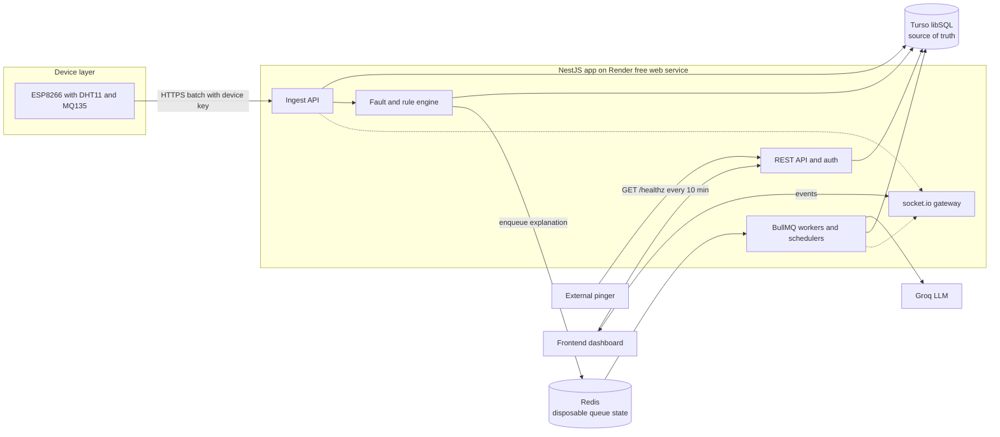
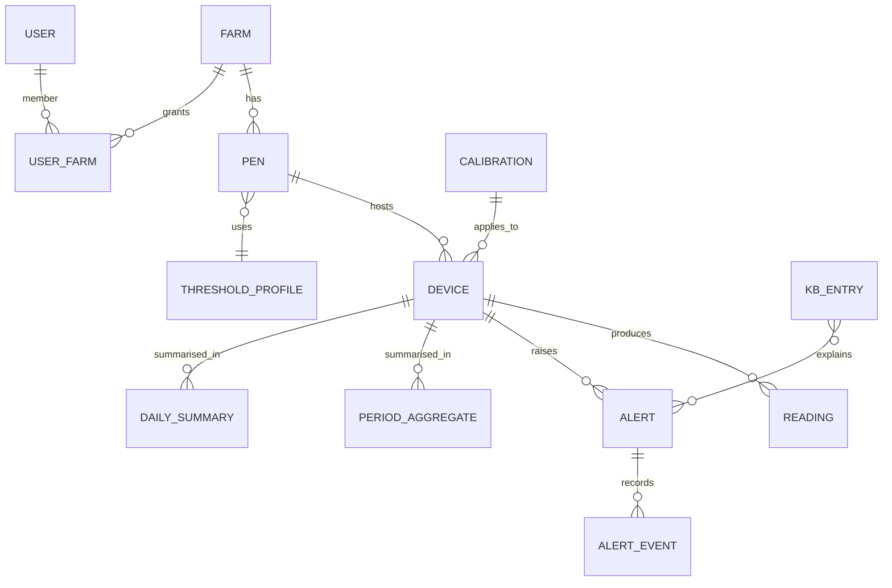
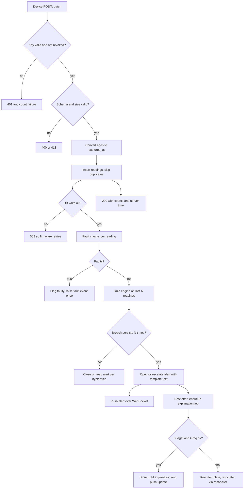
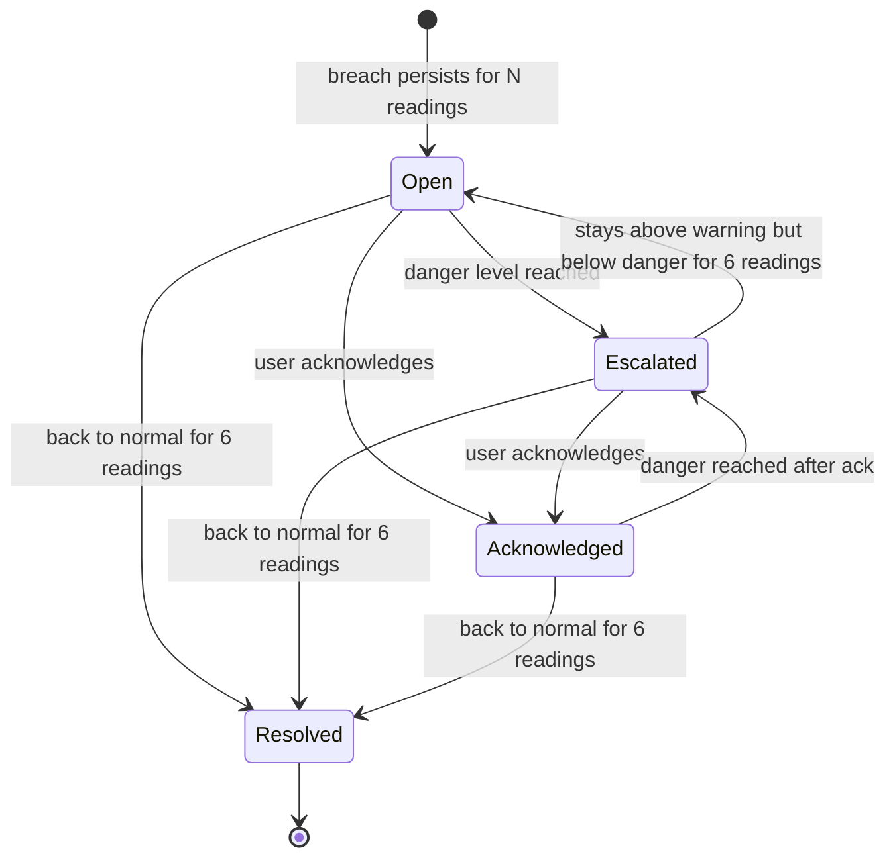
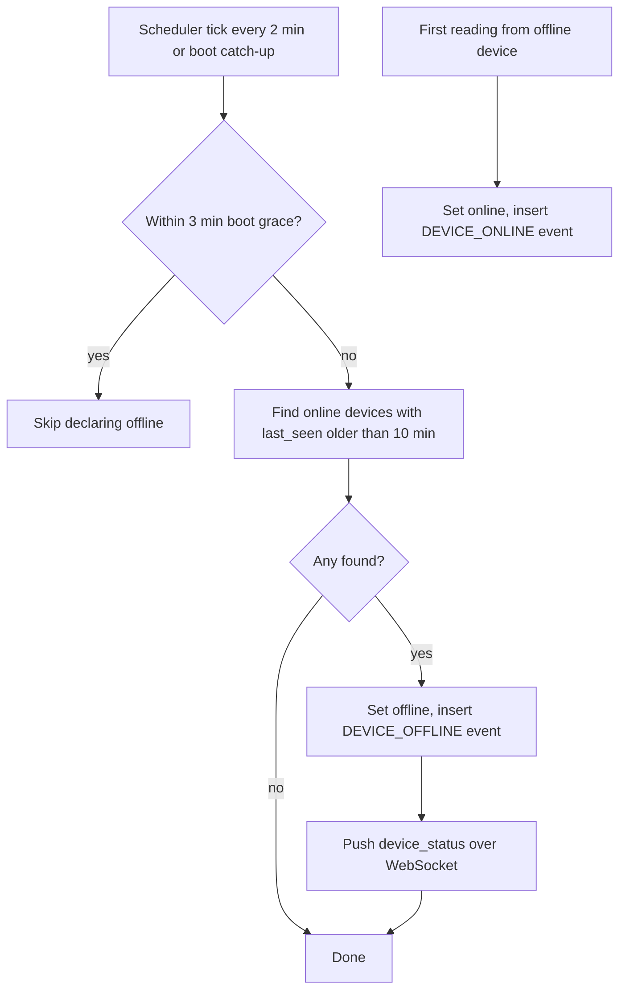
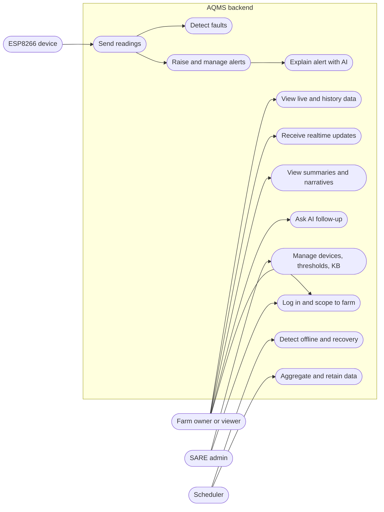

# Architecture

## Functional requirements

Priority: M = Must, S = Should, C = Could, W = Won't (v1).

| ID | Requirement | Pri | Acceptance criteria |
|---|---|---|---|
| <a id="fr-1"></a>FR-1 | Admin can register a device, receive its API key once, rotate it, and revoke it | M | Key shown once; only a hash is stored; a revoked key gets 401 on the next request |
| <a id="fr-2"></a>FR-2 | `POST /api/v1/ingest` accepts a batch of 1 to 60 readings authenticated by device key | M | Valid batch returns 200 with per-batch counts; bad key 401; oversized 413 |
| <a id="fr-3"></a>FR-3 | Ingest is idempotent per (device, boot_id, seq) | M | Replaying the same batch 10 times stores each reading once |
| <a id="fr-4"></a>FR-4 | Each reading's `captured_at` = server receive time minus its `age_s`; device clock is never trusted; `time_quality` is recorded | M | Reading with `age_s` > 24 h or negative is rejected with a reason |
| <a id="fr-5"></a>FR-5 | Store raw MQ135 ADC; compute the NH3 estimate server-side from a versioned calibration | M | Changing calibration changes new estimates without a firmware change; each row records `calib_version` |
| <a id="fr-6"></a>FR-6 | Detect faulty readings (NaN or checksum error, out of sensor range, stuck value, impossible jump, ADC saturated) and store them flagged `faulty` | M | Faulty rows are excluded from rules, aggregates and charts; a `SENSOR_FAULT` event is raised once per fault episode |
| <a id="fr-7"></a>FR-7 | Evaluate thresholds per reading from the pen's threshold profile, with debounce | M | N consecutive breaches (default 3) open an alert; values come from the profile, not code |
| <a id="fr-8"></a>FR-8 | Alerts have a lifecycle: open, acknowledged, resolved; one open alert per (device, sensor); escalation warning to danger; hysteresis on resolve | M | Sustained breach for 24 h produces 1 open alert (plus at most 1 escalation), not 8,640 |
| <a id="fr-9"></a>FR-9 | Every alert gets an immediate template explanation, then an LLM explanation filled asynchronously | M | `explanation_source` is `template` at creation and later `llm`; alert visible before any LLM call |
| <a id="fr-10"></a>FR-10 | LLM calls pass through a budget router (70B, then 8B, then template) with throttling | M | When Groq returns 429 or the daily budget is spent, the alert keeps its template and is retried later without error to the user |
| <a id="fr-11"></a>FR-11 | Knowledge base of tagged entries (sensor, level, combination), with a seed set and admin CRUD | M (seed), S (CRUD) | Query for NH3 danger with high humidity returns the combined entry before generic NH3 entries |
| <a id="fr-12"></a>FR-12 | Detect device offline (default 10 min without a reading) and recovery; raise `DEVICE_OFFLINE` and `DEVICE_ONLINE` events | M | Simulator stopped: event within 12 min while service is awake; first reading afterwards flips status back |
| <a id="fr-13"></a>FR-13 | Device status API: online, offline, faulty, last_seen, firmware version | M | Matches DB state within one sweep interval |
| <a id="fr-14"></a>FR-14 | Latest reading per device and paginated history with date range filter | M | Cursor pagination, max 1,000 rows per page, filter by `from` and `to` |
| <a id="fr-15"></a>FR-15 | Realtime events over WebSocket: `reading`, `alert`, `device_status` | M | Client receives only events for farms it is authorised for |
| <a id="fr-16"></a>FR-16 | Period aggregates (morning 06 to 12, afternoon 12 to 18, evening 18 to 22, night 22 to 06) in the farm's time zone | M | Night period belongs to the date it started; periods with no data are marked, not zero |
| <a id="fr-17"></a>FR-17 | Daily summary computed from raw rows weighted by sample count, plus an AI narrative from the last 3 to 7 daily summaries | M | Narrative job failure does not block the numeric summary |
| <a id="fr-18"></a>FR-18 | Monthly and yearly summaries from daily summaries, with narrative | S | Month with a 3-day outage reports coverage percent |
| <a id="fr-19"></a>FR-19 | AI follow-up chat on an alert or summary, stateless, last 3 to 5 turns in the request | S | Cannot return data of another farm; refuses off-topic requests |
| <a id="fr-20"></a>FR-20 | Responses honour a `lang` parameter from an allowed list; fall back to English | S | Unsupported value returns 400 with the supported list |
| <a id="fr-21"></a>FR-21 | User authentication, roles (admin, owner, viewer) and farm scoping on every read | M | User A cannot read farm B by any endpoint or WebSocket room |
| <a id="fr-22"></a>FR-22 | Retention job deletes raw readings older than the configured days (default 90) in small batches; summaries are kept | M | Job never holds a long transaction; batch size configurable |
| <a id="fr-23"></a>FR-23 | Admin can manage threshold profiles, pens, calibrations and KB entries | S | Changes are audit-logged and take effect within 1 minute |
| <a id="fr-24"></a>FR-24 | `GET /healthz` (no DB, no external calls) and `GET /readyz` (DB and Redis state) | M | `/healthz` p95 under 50 ms |
| <a id="fr-25"></a>FR-25 | OpenAPI documentation published from code | M | CI fails if the spec is out of date |
| <a id="fr-26"></a>FR-26 | Ingest response returns `server_time_ms` and `config_version` so firmware can sync time and interval | C | Firmware can set its sample interval from the response |
| <a id="fr-27"></a>FR-27 | Notification channel interface (webhook, email) behind a port | C | Port exists; no channel is wired in v1 |
| <a id="fr-28"></a>FR-28 | Audit log of admin and security-relevant actions | S | Key rotation, revoke, threshold change, and role change are recorded with actor |
| <a id="fr-29"></a>FR-29 | Device simulator and seed scripts (normal, breach, fault, offline, burst, replay) | M | One command runs a scenario against any environment |
| <a id="fr-30"></a>FR-30 | SMS, WhatsApp, push, actuator control | W | Out of scope v1 |

## Non-functional requirements

| ID | Category | Requirement | How verified |
|---|---|---|---|
| <a id="nfr-1"></a>NFR-1 | Durability | A reading acknowledged with 2xx survives `kill -9` of the process and loss of all Redis data | Chaos test [A-SD2-1](04-requirements.md#a-sd2-1), [A-SD6-3](04-requirements.md#a-sd6-3) |
| <a id="nfr-2"></a>NFR-2 | Latency | Ingest p95 <= 300 ms for a 6-reading batch while the service is awake (excluding Turso network outliers above p99) | Load test, 40 simulated devices |
| <a id="nfr-3"></a>NFR-3 | Throughput | Sustain 40 devices x 1 reading per 10 s (4 req/s unbatched) with no queue backlog | Load test |
| <a id="nfr-4"></a>NFR-4 | Alert latency | Breach to alert row <= 1 s after the debounce count is met; AI never adds to it | Integration test |
| <a id="nfr-5"></a>NFR-5 | Availability | Dev profile: best effort, no SLA. Cold start to first 200 <= 90 s; no data loss across it | Sleep simulation test |
| <a id="nfr-6"></a>NFR-6 | Security | All device and user traffic over HTTPS; device keys 256-bit random, stored hashed; passwords hashed with argon2id | Review, tests |
| <a id="nfr-7"></a>NFR-7 | Privacy | No other farm's data in any LLM prompt; prompts contain numbers and KB text only, no user names or contact data | Prompt snapshot tests |
| <a id="nfr-8"></a>NFR-8 | Cost | Dev profile $0; Turso writes <= 80% of quota at pilot size; Groq tokens <= 80% of daily limit | Write meter, `llm_usage_daily` |
| <a id="nfr-9"></a>NFR-9 | Scalability | Pilot 40 devices; design tolerates 10x with DB change and a second instance (no in-memory authority) | Design review, load test at 10x on Postgres profile |
| <a id="nfr-10"></a>NFR-10 | Observability | Structured JSON logs with request id and device id; counters for ingest accepted, rejected, duplicates, alerts, LLM calls by outcome, queue depth | Log inspection |
| <a id="nfr-11"></a>NFR-11 | Portability | Same test suite passes on libSQL and Postgres | CI matrix |
| <a id="nfr-12"></a>NFR-12 | Data retention | Raw 90 days default, summaries indefinite, alerts 2 years, audit 2 years (all configurable) | Retention job test |
| <a id="nfr-13"></a>NFR-13 | Localization | Timestamps stored in UTC milliseconds; farm time zone default `Africa/Lagos`; all period maths done in farm zone | Period boundary tests |
| <a id="nfr-14"></a>NFR-14 | Maintainability | Rule engine and threshold logic are pure functions with table-driven tests; coverage of those modules >= 90% | CI coverage |

## High-level architecture



Component notes:
- **Ingest API** authenticates, validates, de-duplicates, stores, flags faults, runs the rule engine and returns. It never calls Redis or Groq in the request path except a best-effort enqueue after commit.
- **Rule engine** is a pure function over the last N non-faulty readings and the pen's threshold profile. It holds no in-memory authority, so any instance (or a restarted one) reaches the same decision.
- **Workers** run explanation jobs, summaries, retention and the offline sweep. Schedulers are re-registered idempotently at every boot.
- **Reconciler** (scheduled job) re-enqueues alerts whose `explanation_status` is `pending` and are older than 2 minutes, and runs a catch-up of any missed period aggregates.
- **Single process in dev**: web and workers share one process because the free profile allows one service. Code is split by module so a worker service can be split out at go-live.

## Data model sketch



Key tables (columns abbreviated; time columns are integer epoch milliseconds UTC so the schema is identical on SQLite and Postgres):

| Table | Key columns | Notes |
|---|---|---|
| `farms`, `pens` | id (text, ULID), name, tz, `placed_at`, `bird_type` | `placed_at` and `bird_type` allow age-based thresholds ([Q-3](05-assumptions-risks-questions.md#q-3)) |
| `users`, `user_farms` | id, email, password_hash, role | roles admin, owner, viewer |
| `devices` | id, pen_id, key_hash, status, last_seen_ms, last_seen_written_ms, fw_version, calib_id | `last_seen` written at most once per minute per device |
| `readings` | id, device_id, boot_id, seq, captured_ms, received_ms, temp_c, rh_pct, nh3_raw, nh3_est_ppm, calib_version, status (ok, faulty), fault_code, time_quality | Unique (device_id, boot_id, seq). Index (device_id, captured_ms DESC) |
| `threshold_profiles` | id, name, rules (JSON text) | Per sensor: warn, danger, low bounds, debounce, clear count; optional age bands |
| `alerts` | id, device_id, sensor, level, state, opened_ms, resolved_ms, peak_value, explanation, explanation_source, explanation_status, lang | Partial unique index: one non-resolved alert per (device, sensor) |
| `alert_events` | alert_id, type (opened, escalated, acked, resolved, explained), at_ms, actor | History without rewriting the alert |
| `device_events` | device_id, type (OFFLINE, ONLINE, SENSOR_FAULT, FAULT_CLEARED), at_ms | |
| `period_aggregates`, `daily_summaries` | device_id, local_date, period, avg/min/max per sensor, sample_count, coverage_pct, narrative | Daily is weighted by `sample_count` |
| `monthly_summaries`, `yearly_summaries` | same pattern | |
| `kb_entries` | id, tags (text), sensor, level, combo_key, text, lang | Seeded from a file; admin editable |
| `calibrations` | id, sensor, r0, curve params, valid_from, notes | MQ135 calibration per device or batch |
| `llm_usage_daily` | day (Pacific day for Groq), model, tokens_in, tokens_out, calls, denied | Drives the router |
| `usage_meter` | month, rows_written_estimate | Early warning for the Turso quota |
| `audit_log` | actor, action, target, at_ms | |

**Threshold defaults (pending advisor confirmation, [Q-3](05-assumptions-risks-questions.md#q-3)).** These replace the flat values in the source architecture doc where published guidance disagrees:

| Sensor | Source doc | Published guidance found | Proposed default |
|---|---|---|---|
| NH3 | warn 15, danger 25 ppm | Max 25 ppm; above 10 ppm lung damage; above 20 ppm respiratory issues; EU threshold 20 ppm | warn 15, danger 25 (unchanged, configurable). Note MQ135 datasheet range starts at 10 ppm, so values near 10 are unreliable |
| Temperature | warn 32, danger 38 °C, flat | Brooding starts near 30 to 32 °C and falls to about 19 to 20 °C by day 42 for broilers. Flat 32 would alarm constantly in brooding and miss heat stress later | Age-based target band per pen from `placed_at`; warn at target + 3 °C, danger at target + 6 °C, plus a low-side warning. Without `placed_at`, fall back to warn 32, danger 38 and tag alerts `profile=fallback` |
| Humidity | warn 80, danger 90 % | Recommended 50 to 70 %; above 70 % ammonia rises; too low means dust | warn 75, danger 85, low warn below 40 |
| Fault bounds | temp -10 to 70, RH 0 to 100, NH3 0 to 1000 | DHT11 measures 0 to 50 °C (±2 °C) and 20 to 90 % RH (±5 %); max 1 Hz | Temp outside -5 to 55 and RH outside 5 to 100 are physical impossibilities (faulty). Values outside the 0 to 50 / 20 to 90 operating range are stored with `out_of_spec` and shown with a caution; they do not raise a sensor fault |

## API and integration contracts

**Device ingest**

```
POST /api/v1/ingest
Headers: x-device-key: <256-bit key>, content-type: application/json
Body:
{
  "boot_id": "a1b2c3",          // random per power-up
  "seq": 120,                   // sequence of the FIRST reading in this batch, increments per reading
  "fw": "0.3.1",
  "readings": [
    { "age_s": 50, "t": 28.6, "h": 68, "gas_raw": 412, "dht_ok": true },
    { "age_s": 40, "t": 28.7, "h": 68, "gas_raw": 415, "dht_ok": true }
  ]
}
Response 200: { "accepted": 2, "duplicate": 0, "rejected": [], "server_time_ms": 1760625600000, "config_version": 3 }
Errors: 400 invalid schema (names the field), 401 bad or revoked key, 413 too large (> 16 KB), 429 + Retry-After
Retry rule for firmware: retry on network error, 5xx and 429 with the SAME boot_id and seq; never retry other 4xx.
```

Contract points to confirm with the hardware team ([Q-6](05-assumptions-risks-questions.md#q-6), [Q-7](05-assumptions-risks-questions.md#q-7)): batch sending, `boot_id`, relative ages, raw ADC (and whether the 0 to 1 V ADC range is handled with a divider on their board), TLS approach (pinned fingerprint or CA with NTP, since `setInsecure()` encrypts but does not authenticate the server).

**Dashboard REST** (all under `/api/v1`, bearer JWT, farm-scoped):

| Method and path | Purpose |
|---|---|
| `POST /auth/login`, `POST /auth/refresh` | Sessions |
| `GET /devices`, `GET /devices/:id` | Devices with status |
| `GET /readings/latest?pen=` | Latest per device |
| `GET /readings?device=&from=&to=&cursor=` | History |
| `GET /aggregates?device=&date=&period=` | Period aggregates |
| `GET /summaries/daily`, `/monthly`, `/yearly` | Summaries with narrative |
| `GET /alerts?state=&device=`, `POST /alerts/:id/ack` | Alerts |
| `POST /ai/chat` | Body: `alert_id` or `summary_id`, `lang`, last 3 to 5 turns |
| Admin: `POST /admin/devices`, `POST /admin/devices/:id/rotate-key`, `POST /admin/devices/:id/revoke`, `PUT /admin/thresholds/:id`, `PUT /admin/calibrations/:id`, `CRUD /admin/kb` | Management |
| `GET /healthz`, `GET /readyz` | Ops |

**WebSocket** (socket.io): handshake carries the JWT; the server joins the socket to rooms `farm:<id>` it is authorised for. Events: `reading` (latest per device, throttled to 1 per device per 5 s), `alert` (opened, escalated, resolved, explained), `device_status`. Errors follow `{ "error": { "code", "message", "request_id" } }` everywhere.

**Groq**: OpenAI-compatible chat endpoint; temperature low; hard `max_tokens`; response must be JSON with fields `summary`, `likely_causes`, `actions` (validated; invalid output falls back to the template).

## User flows

**Ingest and alert flow**



**Alert state**



**Offline detection**



## Use case diagram



Coverage: [FR-1](#fr-1), [FR-23](#fr-23), [FR-28](#fr-28) -> UC10; [FR-2](#fr-2) to [FR-5](#fr-5) -> UC1; [FR-6](#fr-6) -> UC2; [FR-7](#fr-7), [FR-8](#fr-8) -> UC3; [FR-9](#fr-9) to [FR-11](#fr-11) -> UC4; [FR-12](#fr-12), [FR-13](#fr-13) -> UC5; [FR-14](#fr-14) -> UC6; [FR-15](#fr-15) -> UC7; [FR-16](#fr-16) to [FR-18](#fr-18), [FR-20](#fr-20) -> UC8; [FR-19](#fr-19) -> UC9; [FR-21](#fr-21) -> UC11; [FR-22](#fr-22) -> UC12; [FR-24](#fr-24) to [FR-26](#fr-26), [FR-29](#fr-29) are platform or tooling requirements with no actor-facing use case.

## Unhappy paths

| ID | Scenario | Impact | Intended behavior | Covered by |
|---|---|---|---|---|
| <a id="up-1"></a>UP-1 | Render free service sleeps (idle 15 min) or restarts at any time | Missed offline alerts, dropped requests for about 1 min | Firmware retries with same `seq`; boot catch-up sweep with 3-min grace; external pinger; documented limitation | [SD2-T4](04-requirements.md#sd2-t4), [SD6-T2](04-requirements.md#sd6-t2), [SD6-T3](04-requirements.md#sd6-t3) |
| <a id="up-2"></a>UP-2 | All devices offline (farm power cut) so service sleeps and no scheduler fires | No offline alert | Pinger keeps it awake in dev; otherwise alert on next wake; go-live uses an always-on instance | [SD6-T3](04-requirements.md#sd6-t3), [OPS4-T1](04-requirements.md#ops4-t1) |
| <a id="up-3"></a>UP-3 | Redis restarted or flushed (free tier is non-persistent) | Queue and scheduler state lost | DB is source of truth; reconciler re-enqueues pending alerts; schedulers re-registered at boot | [SD6-T1](04-requirements.md#sd6-t1), [SD6-T4](04-requirements.md#sd6-t4) |
| <a id="up-4"></a>UP-4 | Redis eviction policy not `noeviction` | BullMQ keys evicted silently | Startup check fails loudly and logs; fallback host | [SD1-T4](04-requirements.md#sd1-t4), [SD6-T1](04-requirements.md#sd6-t1) |
| <a id="up-5"></a>UP-5 | BullMQ completed jobs accumulate | Free Redis fills | `removeOnComplete` and `removeOnFail` limits on every queue | [SD6-T1](04-requirements.md#sd6-t1) |
| <a id="up-6"></a>UP-6 | Turso write quota exhausted | Writes fail with BLOCKED; readings lost | `usage_meter` warning at 70%, degraded mode (drop sampling to 1 per minute, persist alerts only) at 90%, return 503 so firmware keeps buffering | [SD2-T7](04-requirements.md#sd2-t7), [SD7-T7](04-requirements.md#sd7-t7) |
| <a id="up-7"></a>UP-7 | Duplicate batch (firmware retry after lost 200) | Double counting | Unique (device, boot_id, seq) | [SD2-T3](04-requirements.md#sd2-t3) |
| <a id="up-8"></a>UP-8 | Device reboots, `seq` restarts | False duplicates | New `boot_id` per power-up scopes `seq` | [SD2-T3](04-requirements.md#sd2-t3) |
| <a id="up-9"></a>UP-9 | Device clock wrong or unset | Wrong timestamps | Server time authoritative; `age_s` offsets; reject absurd ages | [SD2-T2](04-requirements.md#sd2-t2) |
| <a id="up-10"></a>UP-10 | Burst after outage (hundreds of buffered readings) | Spike in writes and rule evaluations | Batch cap 60; ordered processing; rate limit per device; alerts judged on `captured_at` order | [SD2-T2](04-requirements.md#sd2-t2), [SD3-T3](04-requirements.md#sd3-t3) |
| <a id="up-11"></a>UP-11 | Stolen or leaked device key | Fake data | Rotate and revoke; per-device rate limit; anomaly flag when a key is used from many IPs (log only in v1) | [SD2-T1](04-requirements.md#sd2-t1), [SD7-T6](04-requirements.md#sd7-t6) |
| <a id="up-12"></a>UP-12 | DHT11 returns NaN, checksum failure, or 0 repeated | Bad data in charts or false alerts | Fault rules; excluded from aggregates; one fault event per episode | [SD3-T1](04-requirements.md#sd3-t1) |
| <a id="up-13"></a>UP-13 | MQ135 not warmed up (first 24 h) or drifting | Wrong ppm | `warmup` flag from first-seen time; alerts from MQ135 suppressed or labelled during warm-up; NH3 labelled as estimate | [SD3-T2](04-requirements.md#sd3-t2) |
| <a id="up-14"></a>UP-14 | MQ135 saturated or reading 0 because the ADC input is mis-scaled | Constant false danger or blindness | ADC at 0 or full-scale for 5 readings is a sensor fault with a hardware hint | [SD3-T1](04-requirements.md#sd3-t1) |
| <a id="up-15"></a>UP-15 | Sensor spike lasting 1 reading | False alert | Debounce N consecutive readings | [SD3-T3](04-requirements.md#sd3-t3) |
| <a id="up-16"></a>UP-16 | Value hovers around the threshold | Alert flapping | Hysteresis: resolve only after 6 normal readings; reopen cooldown | [SD3-T4](04-requirements.md#sd3-t4) |
| <a id="up-17"></a>UP-17 | Breach lasts all night | Thousands of alerts and LLM calls | One open alert per (device, sensor); escalate once; re-notify cooldown | [SD3-T4](04-requirements.md#sd3-t4) |
| <a id="up-18"></a>UP-18 | Groq 429, outage or model removal | No explanation | Template immediately; router falls back to 8B then template; retry with backoff; model ids in config | [AI2-T2](04-requirements.md#ai2-t2), [AI2-T3](04-requirements.md#ai2-t3) |
| <a id="up-19"></a>UP-19 | Groq daily token budget exhausted | No explanations until reset | `llm_usage_daily` router; throttle per (device, sensor, level) to 1 per 30 min; narratives use 8B | [AI2-T2](04-requirements.md#ai2-t2) |
| <a id="up-20"></a>UP-20 | LLM returns malformed or unsafe advice (for example medication doses) | Harm or confusion | JSON schema validation; system prompt limits advice to ventilation, litter, water, and "call a vet"; denylist check; fall back to template | [AI2-T4](04-requirements.md#ai2-t4) |
| <a id="up-21"></a>UP-21 | Prompt injection via chat or KB edits | Data leak or off-topic output | User text treated as data; no tools; prompt holds only this farm's numbers; KB edits admin only | [AI3-T3](04-requirements.md#ai3-t3) |
| <a id="up-22"></a>UP-22 | Unsupported language request or poor translation quality | Confusing advice | Allowed list; English fallback; Yoruba and other languages marked beta until reviewed by a speaker ([Q-9](05-assumptions-risks-questions.md#q-9)) | [AI2-T5](04-requirements.md#ai2-t5) |
| <a id="up-23"></a>UP-23 | Two instances or overlapping jobs run the same schedule | Duplicate summaries or alerts | Unique constraints on (device, date, period); idempotent job ids; partial unique index on open alerts | [SD6-T4](04-requirements.md#sd6-t4), [SD7-T1](04-requirements.md#sd7-t1) |
| <a id="up-24"></a>UP-24 | Job crashes mid-aggregate | Missing summary | Idempotent upserts; reconciler recomputes missing periods for the last 7 days | [SD7-T4](04-requirements.md#sd7-t4) |
| <a id="up-25"></a>UP-25 | Period boundary, daylight saving, wrong time zone | Wrong aggregates | All boundaries in farm zone; Lagos has no DST but code must not assume; boundary tests | [SD7-T1](04-requirements.md#sd7-t1) |
| <a id="up-26"></a>UP-26 | Device offline for part of a day | Misleading averages | `coverage_pct` and sample counts; weighted daily averages; narrative told about gaps | [SD7-T2](04-requirements.md#sd7-t2) |
| <a id="up-27"></a>UP-27 | Retention delete locks the DB or burns write quota | Slow ingest | Small batches, off-peak, throttled; counted in write budget | [SD7-T5](04-requirements.md#sd7-t5) |
| <a id="up-28"></a>UP-28 | User A reads farm B (ID guessing) | Data breach | Farm scope in every query; ULIDs; WebSocket room authorisation tests | [SD4-T3](04-requirements.md#sd4-t3), [SD5-T2](04-requirements.md#sd5-t2) |
| <a id="up-29"></a>UP-29 | Token theft or expired JWT during a WebSocket session | Stale access | Short-lived access token; server disconnects expired sockets; refresh flow | [SD4-T2](04-requirements.md#sd4-t2), [SD5-T2](04-requirements.md#sd5-t2) |
| <a id="up-30"></a>UP-30 | Admin mistake: revokes the wrong device, deletes a threshold profile in use | Outage of alerts | Confirmation by name, soft delete, audit log, profile in use cannot be deleted | [SD7-T6](04-requirements.md#sd7-t6) |
| <a id="up-31"></a>UP-31 | Pen's `placed_at` missing or wrong | Wrong temperature band | Fallback flat profile and visible `profile=fallback` tag | [SD3-T2](04-requirements.md#sd3-t2) |
| <a id="up-32"></a>UP-32 | Deploy breaks schema or Turso migration fails midway | Downtime | Forward-only migrations, tested on both dialects, backup before migrate | [SD1-T3](04-requirements.md#sd1-t3), [OPS3-T2](04-requirements.md#ops3-t2) |
| <a id="up-33"></a>UP-33 | Secrets leaked or Groq key abused | Cost or quota theft | Env-only secrets, rotation procedure, per-day budget protects quota | [OPS3-T1](04-requirements.md#ops3-t1) |
| <a id="up-34"></a>UP-34 | Free-tier account suspended or terms change (Render, Redis Cloud inactivity deletion at 14 days) | Loss of service | Monitoring, backup export, documented migration path, Redis treated as disposable | [OPS3-T2](04-requirements.md#ops3-t2), [OPS4-T1](04-requirements.md#ops4-t1) |
| <a id="up-35"></a>UP-35 | New firmware sends an unknown field or changes units | Silent bad data | Strict schema with `fw` version gate; unknown fields rejected in dev, logged in prod | [SD2-T2](04-requirements.md#sd2-t2) |

## Security, privacy, and compliance

- **Who attacks what:** anyone on the internet can reach `/ingest` and `/auth/login`; a leaked device key lets an attacker inject readings (including hiding a real fault); a compromised user account reads a farm's data; a prompt-injection attempt targets the chat endpoint.
- **Sensitive data:** user emails and password hashes, device key hashes, farm identities and locations, LLM prompts (numbers only), API secrets.
- **Controls:** HTTPS only (Render terminates TLS); device key in a header, 256-bit random, SHA-256 hashed at rest (adequate because the keys are high-entropy), constant-time compare; per-device and per-IP rate limits; argon2id for passwords; short-lived JWT plus refresh; CORS allowlist; request size caps; farm scoping in the repository layer so it cannot be forgotten in a controller; no PII in prompts; audit log for admin actions.
- **Residual risk to accept in dev:** firmware that uses `setInsecure()` encrypts but cannot detect a man-in-the-middle; pinned fingerprint or CA validation is the fix ([Q-7](05-assumptions-risks-questions.md#q-7)).
- **Compliance:** not assessed ([Q-11](05-assumptions-risks-questions.md#q-11)).

## Observability and operations

- **Logs:** pino JSON to stdout (Render captures them); every ingest logs device id, counts and duration. Never log keys or full prompts.
- **Metrics:** counters in memory exposed on an authenticated `/admin/metrics`, plus DB tables `usage_meter` and `llm_usage_daily` that survive restarts.
- **Alerts to the team:** the external pinger doubles as a dead-man check on `/healthz` and emails the team when it fails twice.
- **Backups:** scheduled export of Turso data (weekly GitHub Action dumping to private storage). Point-in-time recovery of 1 day on the free plan appears in secondary sources only (Unverified); do not rely on it.
- **Deploy and rollback:** deploy from Git; migrations forward-only; rollback means redeploying the previous commit; schema changes are additive first, destructive in a later release.
- **Runbook:** one page covering "service asleep", "Redis wiped", "Turso BLOCKED", "Groq 429 storm", "device key leak".

## Testing strategy

- **Unit:** rule engine, fault rules, hysteresis, period boundary maths, NH3 calibration curve. Table-driven, pure functions.
- **Integration:** real libSQL (file) and real Postgres in CI for all repository tests; BullMQ against a Redis container.
- **Contract:** ingest JSON schema shared with the firmware team; golden payload files; a simulator that speaks exactly that contract.
- **Chaos:** `kill -9` during a batch; flush Redis mid-run; simulate Render sleep (stop process 20 min, then restart); Groq returning 429, 500, malformed JSON.
- **Load:** 40 simulated devices at 10 s for 1 hour; burst of 500 buffered readings from one device.
- **AI quality:** fixed set of 20 alert scenarios; checks for schema validity, no medication advice, correct language, and no data from other farms; human review of a sample before go-live.
- **Security:** authorisation tests across two farms for every endpoint and the WebSocket; dependency audit in CI.

Next: [Requirements](04-requirements.md)
