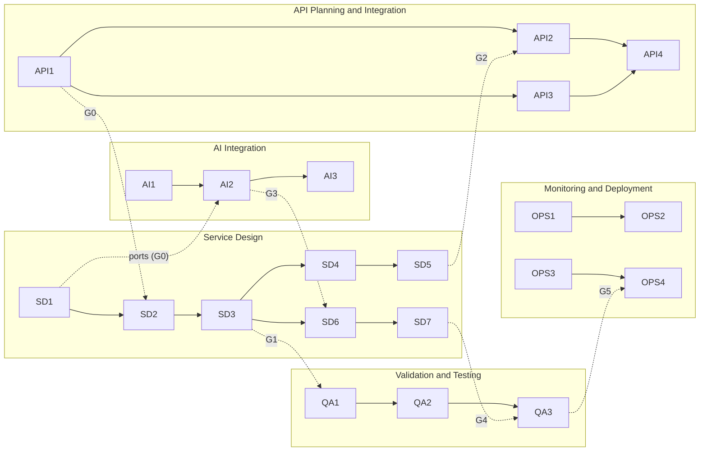

# Requirements

Milestones are grouped by team role so each person can work independently and converge at defined gates. Task bodies are carried over from the earlier M0 to M10 plan (see the [old-to-new ID map](#old-to-new-id-map)); ownership, ports and convergence gates are new.

Sizes: S = under 1 day, M = 1 to 3 days, L = 3 to 5 days (one developer).

## Roles and workstreams

| Role | Prefix | Milestones | Nature of the work | When it is busiest |
|---|---|---|---|---|
| Service Design | SD | SD1 to SD7 | Builds the backend: schema, ingest, rules, alerts, auth, realtime, jobs, aggregates. Builds **premature interfaces** (ports with stub implementations) for everything the other roles own | From day 1 to feature complete |
| API Planning and Integration | API | API1 to API4 | Defines the contract up front; afterwards reads and lightly modifies the service team's endpoints; integrates with the frontend and hardware teams; documents | API1 early, API2 to API4 once SD endpoints exist; change requests any time |
| AI Integration | AI | AI1 to AI3 | Builds the full AI engine: workflow, knowledge base and retrieval, prompts, budget router, safety, narratives, chat | Starts day 1 against ports and fixtures; plugs in at gate G3 |
| Backend Validation and Testing | QA | QA1 to QA3 | Verifies endpoints before they go to the frontend, then runs the full integration test; reports issues to the API role | QA1 rolling from first endpoint; QA2 and QA3 after SD is mostly done |
| Monitoring and Deployment | OPS | OPS1 to OPS4 | Sets up monitoring for backend and frontend, backups, runbooks, go-live | Mostly after SD is done; OPS1 can start once `/healthz` exists |

Rule for who edits what: SD owns the code of the core modules. API may modify controllers, DTOs, response shapes and OpenAPI annotations in SD's modules for integration needs ("tweak code slightly"), through small PRs that SD reviews. AI owns the `ai` module and `knowledge` module internals. QA and OPS do not change product code except tests and instrumentation configuration; defects go back to API (endpoint issues) or the owning role.

## Ports: how SD and AI work independently

SD defines these interfaces in SD1-T7 and ships stub implementations so the whole system runs without the AI engine. AI builds the real implementations against fixtures and swaps them in at gate G3. API reads the same interfaces to know what the endpoints return.

| Port | Used by | SD stub (until AI lands) | Real implementation |
|---|---|---|---|
| `ExplanationService.explain(alertContext) -> Explanation` | Alert flow, reconciler (SD3, SD6) | Template text, `explanation_source=template` ([SD3-T5](#sd3-t5)) | AI2: prompt, router, Groq, safety |
| `NarrativeService.summarise(dailySummaries[], lang) -> Narrative or null` | Summary job (SD7) | Returns null; numeric summary stands | AI3-T1 |
| `ChatService.reply(scopeRef, turns[], lang) -> Reply` | Chat endpoint | Returns "assistant unavailable" | AI3-T2, AI3-T3 |
| `KnowledgeLookup.find(sensor, level, tags[]) -> KbEntry[]` | AI engine (and templates, optionally) | Static seed array | AI1-T3 |
| `NotificationChannel.send(event)` | Alert flow | No-op ([FR-27](03-architecture.md#fr-27)) | Not in v1 |

Contract rules: ports take and return plain, serialisable types defined in a shared `contracts` folder; a port never receives another farm's data or user contact data ([NFR-7](03-architecture.md#nfr-7)); changing a port signature needs a note to the other roles and a version bump of the contract. Retrieval inside AI (tags now, embeddings possible later) is hidden behind `KnowledgeLookup`, so the retrieval decision ([DR-5](02-tech-stack.md#dr-5), [Q-14](05-assumptions-risks-questions.md#q-14)) does not affect SD or API.

## Convergence gates

| Gate | Condition | Who converges | Unblocks |
|---|---|---|---|
| G0 Contracts frozen v0 | [API1](#api1) sign-off and [SD1-T7](#sd1-t7) ports published | SD, API, AI | SD2 and SD4 endpoint shapes; AI1 and AI2 fixtures |
| G1 First vertical slice | SD1 + SD2 + SD3 with simulator: reading to alert row to `GET /readings/latest` | SD | QA1 starts; API3 can try a real device |
| G2 Frontend-ready | SD4 + SD5 done, [QA1-T3](#qa1-t3) verification passed, API2 shapes agreed | SD, QA, API | Frontend team integrates |
| G3 AI plugged in | AI2 passes its evaluation on fixtures; SD3 alerts and SD6 queue exist | AI, SD | Swap stubs for real engine; AI3 narrative and chat go live |
| G4 Feature complete | SD1 to SD7, AI1 to AI3, API1 to API3 done | all | QA3 full integration test, OPS3 and OPS4 |
| G5 Release | QA3 sign-off, OPS1 to OPS3 done, Q-1 decided | QA, OPS | OPS4 go-live |

Suggested start order for a team working in parallel: SD1 + API1 + AI1 + OPS1 planning on day 1; SD2 and SD3 next (first vertical slice, G1); QA1 and API3 start at G1; AI2 runs alongside SD4 to SD7; QA2 and OPS2/OPS3 follow as each SD milestone lands.

---

## Service Design

Owner: Service Design role. This role carries most of the backend. Each milestone below is independently shippable and ends with a gate or a handoff.

### Milestone SD1: Foundations, spikes and ports

Goal: a deployable skeleton, the infrastructure unknowns measured, and the interfaces other roles build against.
Definition of done: skeleton deployed to Render; spike results written into the [Assumption Ledger](05-assumptions-risks-questions.md#assumption-ledger); ports published (gate G0 with API1).
Depends on: accounts ([Groundwork](01-overview.md#groundwork-settle-before-or-during-sd1)).
Covers: [NFR-11](03-architecture.md#nfr-11), [NFR-14](03-architecture.md#nfr-14), [FR-24](03-architecture.md#fr-24) (`/healthz`), [FR-29](03-architecture.md#fr-29), [UP-4](03-architecture.md#up-4), [UP-32](03-architecture.md#up-32).
Hands off to: all roles (ports, skeleton, simulator).

- [ ] SD1-T1 Repo, NestJS skeleton, lint, CI, `/healthz` (S)
  - [ ] SD1-T1.1 Module layout: ingest, rules, alerts, devices, auth, ai, knowledge, jobs, summaries
  - [ ] SD1-T1.2 Config module with schema validation (fail fast on missing env)
  Acceptance: CI green; `/healthz` returns 200 without touching DB or Redis.
- [ ] SD1-T2 Deploy to Render free, plus external pinger (S)
  - [ ] SD1-T2.1 `render.yaml`, env vars, TLS check from a laptop
  - [ ] SD1-T2.2 Pinger every 10 min on `/healthz`; record real spin-up time (alerting on pinger failure is [OPS1-T2](#ops1-t2))
  Acceptance: service stays awake 24 h with the pinger; spin-up time recorded.
- [ ] SD1-T3 Repository layer with Drizzle, dual-dialect CI matrix (M)
  - [ ] SD1-T3.1 sqlite/turso and postgres schema files kept in sync by a test
  - [ ] SD1-T3.2 Migration runner and rollback procedure
  Acceptance: same repository test suite passes on libSQL and Postgres.
- [ ] SD1-T4 Spike S2: BullMQ on Render Key Value free (S)
  - [ ] SD1-T4.1 Confirm `maxmemory-policy` can be set to `noeviction`; confirm size limit
  - [ ] SD1-T4.2 Measure idle command rate and memory with one queue and two schedulers
  - [ ] SD1-T4.3 If it fails, try Redis Cloud free and record latency
  Acceptance: documented go or no-go for each host.
- [ ] SD1-T5 Spike S1: Turso write accounting (S)
  - [ ] SD1-T5.1 Insert 10,000 rows into an indexed table, read usage from the Turso dashboard or API
  - [ ] SD1-T5.2 Delete 10,000 rows; check if deletes count
  Acceptance: measured writes per reading and per delete replace the estimates in [Estimated running cost and capacity](02-tech-stack.md#estimated-running-cost-and-capacity).
- [ ] SD1-T6 Spike S3: simulator and device scenarios (M)
  - [ ] SD1-T6.1 Scenarios: normal, ammonia ramp, heat, fault (NaN, stuck), offline, burst, replay
  Acceptance: one command runs a scenario against any base URL ([FR-29](03-architecture.md#fr-29)). QA and API reuse it.
- [ ] SD1-T7 Ports, stubs and shared contracts (M) *(new)*
  - [ ] SD1-T7.1 `contracts` folder with plain types for the ports in [Ports](#ports-how-sd-and-ai-work-independently) and for the alert, reading and summary shapes
  - [ ] SD1-T7.2 Stub implementations wired through DI so the app runs end to end with no AI engine
  - [ ] SD1-T7.3 Short interface note per port (inputs, outputs, error behaviour, who calls it)
  Acceptance: AI can compile an implementation against each port and run it with fixtures; swapping stub for real implementation needs a DI binding change only.

### Milestone SD2: Device registry and durable ingest

Goal: readings from a device reach the DB safely.
Definition of done: simulator runs 1 hour at 40 devices with zero loss and zero duplicates; [A-SD2-1](#a-sd2-1) passes.
Depends on: SD1; ingest contract from [API1](#api1) (gate G0).
Covers: [FR-1](03-architecture.md#fr-1) to [FR-5](03-architecture.md#fr-5), [FR-26](03-architecture.md#fr-26), [NFR-1](03-architecture.md#nfr-1) to [NFR-3](03-architecture.md#nfr-3), [UP-6](03-architecture.md#up-6) to [UP-11](03-architecture.md#up-11), [UP-35](03-architecture.md#up-35).
Hands off to: API3 (real-device testing), QA1.

- [ ] SD2-T1 Device registry and key lifecycle (M)
  - [ ] SD2-T1.1 Create, rotate, revoke endpoints (admin guarded later by SD4)
  - [ ] SD2-T1.2 Key generation, hashing, constant-time verify, per-device rate limit
  Acceptance: revoked key rejected on next request; key never logged.
- [ ] SD2-T2 Ingest endpoint and validation (M)
  - [ ] SD2-T2.1 Strict schema, 16 KB cap, batch max 60
  - [ ] SD2-T2.2 `captured_at` from `age_s`, `time_quality`, reject impossible ages
  - [ ] SD2-T2.3 Response with `server_time_ms` and `config_version`
  Acceptance: contract tests from the golden payloads ([API1-T4](#api1-t4)) pass.
- [ ] SD2-T3 Idempotent storage (M)
  - [ ] SD2-T3.1 Unique (device_id, boot_id, seq); batch insert in one transaction; count duplicates
  Acceptance: replay test stores each reading once; reboot with new boot_id works.
- [ ] SD2-T4 Cold-start behaviour (S)
  - [ ] SD2-T4.1 Ingest returns 503 (not 200) if the DB write failed
  - [ ] SD2-T4.2 Graceful shutdown drains in-flight requests on SIGTERM
  Acceptance: [A-SD2-1](#a-sd2-1) (kill -9 mid-batch loses no acknowledged reading).
- [ ] SD2-T5 NH3 calibration (M)
  - [ ] SD2-T5.1 Calibration table and curve function; store raw and estimate
  Acceptance: changing a calibration changes new rows only; `calib_version` recorded.
- [ ] SD2-T6 `last_seen` throttling (S)
  - [ ] SD2-T6.1 Write at most once per minute per device; first reading after offline always writes
  Acceptance: write meter shows at most 1 `devices` update per device-minute.
- [ ] SD2-T7 Write meter and degraded mode (M)
  - [ ] SD2-T7.1 `usage_meter` increments; warnings at 70% and degraded mode at 90%
  Acceptance: forced low quota test switches to degraded mode and back.

### Milestone SD3: Fault detection, rules and alert lifecycle

Goal: correct, non-noisy alerts without AI.
Definition of done: scenario suite (ramp, spike, hover, fault, all-night breach) yields the expected alert rows. With SD2 this completes the first vertical slice (gate G1).
Depends on: SD2; threshold sign-off ([Q-3](05-assumptions-risks-questions.md#q-3)).
Covers: [FR-6](03-architecture.md#fr-6) to [FR-9](03-architecture.md#fr-9) (template part), [NFR-4](03-architecture.md#nfr-4), [NFR-14](03-architecture.md#nfr-14), [UP-12](03-architecture.md#up-12) to [UP-17](03-architecture.md#up-17), [UP-31](03-architecture.md#up-31).
Hands off to: QA1/QA2 (alert tests), AI2 (real alert records for integration).

- [ ] SD3-T1 Fault rules (M)
  - [ ] SD3-T1.1 NaN or `dht_ok=false`, impossible range, stuck value over N readings, jump over limit, ADC saturation
  - [ ] SD3-T1.2 One `SENSOR_FAULT` per episode, `FAULT_CLEARED` after M good readings
  Acceptance: faulty rows excluded from rules; fault event not repeated.
- [ ] SD3-T2 Threshold profiles and age bands (M)
  - [ ] SD3-T2.1 Profile schema, default broiler profile, fallback profile
  - [ ] SD3-T2.2 MQ135 warm-up flag and `out_of_spec` handling
  Acceptance: table-driven tests for each sensor and age band.
- [ ] SD3-T3 Rule engine with debounce (M)
  - [ ] SD3-T3.1 Pure function over last N non-faulty readings; evaluates in `captured_at` order
  Acceptance: 2 breaching readings do not alert; 3 do.
- [ ] SD3-T4 Alert lifecycle (M)
  - [ ] SD3-T4.1 Partial unique index for one non-resolved alert per (device, sensor)
  - [ ] SD3-T4.2 Escalation, hysteresis (6 normal readings), ack, cooldown
  - [ ] SD3-T4.3 `alert_events` history
  Acceptance: 24 h sustained breach yields 1 alert plus at most 1 escalation.
- [ ] SD3-T5 Template explanations as the `ExplanationService` stub (S)
  - [ ] SD3-T5.1 Per sensor and level text with the measured value and generic safe actions
  - [ ] SD3-T5.2 Alert creation calls the port after commit, best effort; alert row has `explanation_status=pending`
  Acceptance: every new alert has `explanation_source=template` before any LLM call.

### Milestone SD4: Auth, farm scoping and read services

Goal: secure, farm-scoped data access.
Definition of done: two-farm authorisation suite green on every endpoint (suite written by [QA1-T4](#qa1-t4), SD makes it pass).
Depends on: SD2 (data), SD3 (alerts); decisions [Q-2](05-assumptions-risks-questions.md#q-2).
Covers: [FR-13](03-architecture.md#fr-13), [FR-14](03-architecture.md#fr-14), [FR-21](03-architecture.md#fr-21), [FR-23](03-architecture.md#fr-23), [FR-28](03-architecture.md#fr-28), [UP-28](03-architecture.md#up-28), [UP-29](03-architecture.md#up-29).
Hands off to: API2 (read endpoints), QA1 (verification), SD5.

- [ ] SD4-T1 Users, roles, farms, pens (M)
  - [ ] SD4-T1.1 Schema, seed admin, argon2id hashing
  Acceptance: admin can create a farm, pen and owner account.
- [ ] SD4-T2 Login, refresh, guards (M)
  - [ ] SD4-T2.1 Short-lived access token, refresh rotation, logout
  Acceptance: expired token rejected; refresh works once.
- [ ] SD4-T3 Farm scoping in the repository layer (M)
  - [ ] SD4-T3.1 Every query takes a scope object; lint rule blocks unscoped access
  Acceptance: cross-farm tests return 404 for every endpoint.
- [ ] SD4-T4 Read endpoints (M)
  - [ ] SD4-T4.1 devices, latest, history with cursor, alerts, ack
  Acceptance: pagination stable under concurrent inserts.
- [ ] SD4-T5 Audit log (S)
  - [ ] SD4-T5.1 Admin and security-relevant actions logged with actor
  Acceptance: key rotation, revoke, threshold change and role change each produce an audit row.
- [ ] SD4-T6 Admin configuration endpoints (M) *(new; the earlier plan listed these endpoints but had no task)*
  - [ ] SD4-T6.1 `PUT /admin/thresholds/:id` and `PUT /admin/calibrations/:id`, audit-logged, cached for at most 1 minute
  Acceptance: a threshold change takes effect within 1 minute ([FR-23](03-architecture.md#fr-23)). KB admin endpoints belong to [AI1-T3](#ai1-t3).

### Milestone SD5: Realtime

Goal: dashboard updates without polling.
Definition of done: p95 reading-to-client latency <= 2 s on the simulator.
Depends on: SD4.
Covers: [FR-15](03-architecture.md#fr-15), [UP-28](03-architecture.md#up-28), [UP-29](03-architecture.md#up-29).
Hands off to: API2 (client event contract), QA2 (realtime tests). Completes gate G2 with SD4.

- [ ] SD5-T1 socket.io gateway on the same server (M)
  - [ ] SD5-T1.1 JWT handshake, rooms per farm, throttle `reading` to 1 per device per 5 s
  Acceptance: client gets events only for its farm.
- [ ] SD5-T2 Expiry and reconnect handling (S)
  - [ ] SD5-T2.1 Disconnect on token expiry; client refresh and rejoin; missed-event catch-up via REST `since` parameter
  Acceptance: reconnect after 2 min loses no alert (client fetches since last id).
- [ ] SD5-T3 Wake-on-connect check (S)
  - [ ] SD5-T3.1 Verify a new WebSocket connection wakes a sleeping Render service and the client shows a "waking up" state (client side with API2)
  Acceptance: documented behaviour and measured wake time.

### Milestone SD6: Scheduler, offline detection and reconciler

Goal: background work that survives sleep, restart and Redis loss.
Definition of done: [A-SD6-1](#a-sd6-1) to [A-SD6-3](#a-sd6-3) pass.
Depends on: [SD1-T4](#sd1-t4), SD3.
Covers: [FR-12](03-architecture.md#fr-12), [FR-24](03-architecture.md#fr-24) (`/readyz`), [UP-1](03-architecture.md#up-1) to [UP-5](03-architecture.md#up-5), [UP-23](03-architecture.md#up-23).
Hands off to: AI2 (queue and handler registration for explanation jobs), QA2 (job tests), OPS1 (queue depth, heartbeat).

- [ ] SD6-T1 Queue module (M)
  - [ ] SD6-T1.1 BullMQ queues, retry with backoff, `removeOnComplete` and `removeOnFail` caps, graceful close
  - [ ] SD6-T1.2 Startup check of eviction policy; fail loudly
  - [ ] SD6-T1.3 `GET /readyz` reporting DB and Redis state
  - [ ] SD6-T1.4 Documented way for other modules (AI) to register a job handler
  Acceptance: queue memory stays flat over a 24 h run.
- [ ] SD6-T2 Offline sweep (M)
  - [ ] SD6-T2.1 Scheduler every 2 min; 10 min threshold; 3 min boot grace
  - [ ] SD6-T2.2 Recovery on first reading; `device_events` and WebSocket push
  Acceptance: [A-SD6-1](#a-sd6-1) simulator stop yields OFFLINE within 12 min; restart yields ONLINE.
- [ ] SD6-T3 Boot catch-up and keep-alive (S)
  - [ ] SD6-T3.1 On boot run sweep and aggregate catch-up; document the pinger and its limits
  Acceptance: [A-SD6-2](#a-sd6-2) stop service 30 min with devices silent; on wake, OFFLINE events appear within 5 min.
- [ ] SD6-T4 Idempotent schedulers and reconciler (M)
  - [ ] SD6-T4.1 `upsertJobScheduler` at boot; deterministic job ids
  - [ ] SD6-T4.2 Reconciler re-enqueues pending explanations older than 2 min through the `ExplanationService` port (works with the stub now, the real engine after G3)
  Acceptance: [A-SD6-3](#a-sd6-3) flush Redis mid-run; all pending alerts still get explained and schedulers resume.

### Milestone SD7: Aggregates, summaries, retention and operability hooks

Goal: trustworthy history, and the instrumentation OPS needs.
Definition of done: aggregates reproducible from raw data; retention runs without affecting ingest; metrics endpoint live.
Depends on: SD6.
Covers: [FR-16](03-architecture.md#fr-16) to [FR-18](03-architecture.md#fr-18) (numeric part and port call), [FR-22](03-architecture.md#fr-22), [NFR-10](03-architecture.md#nfr-10), [NFR-12](03-architecture.md#nfr-12), [NFR-13](03-architecture.md#nfr-13), [UP-6](03-architecture.md#up-6), [UP-11](03-architecture.md#up-11), [UP-23](03-architecture.md#up-23) to [UP-27](03-architecture.md#up-27), [UP-30](03-architecture.md#up-30).
Hands off to: AI3 (summary data for narratives), OPS1 (metrics), QA2/QA3. Completes SD for gate G4.

- [ ] SD7-T1 Period aggregates (M)
  - [ ] SD7-T1.1 Farm-zone boundaries, night attribution, unique (device, date, period)
  Acceptance: boundary tests at 05:59, 06:00, 21:59, 22:00 and across midnight.
- [ ] SD7-T2 Daily summary (M)
  - [ ] SD7-T2.1 Weighted by sample count; `coverage_pct`
  Acceptance: a day with a 6-hour outage reports 75% coverage and correct averages.
- [ ] SD7-T3 Narrative hook (S)
  - [ ] SD7-T3.1 Daily job calls `NarrativeService` with the last 3 to 7 summaries; stores the result; monthly and yearly rollups from daily summaries (numeric)
  Acceptance: narrative failure or null (stub) leaves the numeric summary intact.
- [ ] SD7-T4 Catch-up recompute (S)
  - [ ] SD7-T4.1 Job recomputes missing periods for the last 7 days on boot and daily
  Acceptance: deleting an aggregate row is repaired within one run.
- [ ] SD7-T5 Retention (S)
  - [ ] SD7-T5.1 Batched deletes (for example 5,000 rows per run), off-peak, counted in the write meter
  Acceptance: ingest p95 unchanged during a retention run.
- [ ] SD7-T6 Admin safety (S)
  - [ ] SD7-T6.1 Soft delete, confirmation by name, in-use profile guard
  Acceptance: a threshold profile in use cannot be deleted; revoke needs the device name.
- [ ] SD7-T7 Instrumentation (S)
  - [ ] SD7-T7.1 Structured JSON logs with request id and device id; in-memory counters; authenticated `/admin/metrics`
  - [ ] SD7-T7.2 `usage_meter` and `llm_usage_daily` readable by the metrics endpoint
  Acceptance: counters for ingest accepted, rejected, duplicates, alerts, LLM calls by outcome, queue depth are present ([NFR-10](03-architecture.md#nfr-10)).

---

## API Planning and Integration

Owner: API role. Starts with planning that feeds SD, then works on the service team's endpoints. Frontend and hardware teams can ask this role for a change at any time.

### Milestone API1: Endpoint planning and contract

Goal: one agreed contract for frontend and hardware before SD writes the controllers.
Definition of done: contract v0 signed off by the frontend lead and the hardware lead (gate G0 with SD1-T7).
Depends on: nothing; runs parallel with SD1.
Covers: [FR-2](03-architecture.md#fr-2), [FR-20](03-architecture.md#fr-20), [UP-35](03-architecture.md#up-35); open questions [Q-6](05-assumptions-risks-questions.md#q-6), [Q-7](05-assumptions-risks-questions.md#q-7).
Hands off to: SD2, SD4, SD5 (shapes), QA1 (golden payloads), AI (response shapes for summaries and chat).

- [ ] API1-T1 Endpoint inventory (S)
  - [ ] API1-T1.1 List every frontend endpoint and every hardware endpoint, with purpose and data handled, starting from [API and integration contracts](03-architecture.md#api-and-integration-contracts)
  Acceptance: each frontend screen and each device behaviour maps to at least one endpoint or event.
- [ ] API1-T2 Conventions (S)
  - [ ] API1-T2.1 Naming, versioning, error envelope `{error:{code,message,request_id}}`, cursor pagination, `lang` parameter, WebSocket event schemas
  Acceptance: conventions page reviewed by SD and the frontend lead.
- [ ] API1-T3 Firmware contract workshop, spike S4 (S)
  - [ ] API1-T3.1 Agree batching, boot_id, relative ages, raw ADC, retry rule, TLS approach, ADC scaling
  Acceptance: ingest contract signed off by the hardware lead ([Q-6](05-assumptions-risks-questions.md#q-6), [Q-7](05-assumptions-risks-questions.md#q-7)).
- [ ] API1-T4 JSON schemas and golden payloads (S)
  - [ ] API1-T4.1 Request/response schemas and sample files for normal, faulty, duplicate, oversized and bad-key cases
  Acceptance: files committed in `contracts`; SD2 and QA1 both use them.
- [ ] API1-T5 Review and sign-off (S)
  - [ ] API1-T5.1 Review meeting with frontend and hardware teams; changes recorded
  Acceptance: contract v0 tagged; later changes go through [API2-T3](#api2-t3).

### Milestone API2: Frontend integration

Goal: the frontend team can build against real, documented endpoints.
Definition of done: a frontend developer completes login to live chart; spec drift fails CI.
Depends on: SD4, SD5 (gate G2 with QA1-T3).
Covers: [FR-25](03-architecture.md#fr-25), [FR-15](03-architecture.md#fr-15) (client contract), [FR-20](03-architecture.md#fr-20).
Hands off to: API4 (docs), QA3 (integration test).

- [ ] API2-T1 OpenAPI from code and drift check (S)
  - [ ] API2-T1.1 Generate the spec in CI; fail when it is out of date
  Acceptance: CI fails on spec drift.
- [ ] API2-T2 Frontend wiring pass (M)
  - [ ] API2-T2.1 CORS allowlist, auth flow, pagination and `since` catch-up, WebSocket connect and reconnect, "waking up" state, with the frontend team on the dev deployment
  - [ ] API2-T2.2 Adjust DTOs and response shapes in SD modules where the frontend needs them (small PRs, SD reviews)
  Acceptance: login, device list, live chart, alert list and acknowledge work from the real frontend against dev.
- [ ] API2-T3 Change-request lane (standing)
  - [ ] API2-T3.1 Intake note: who asks, what they need, ticket, turnaround; re-run the affected QA1 checks after each change
  Acceptance: every change appears in the contract changelog and the OpenAPI diff.

### Milestone API3: Hardware integration

Goal: a real device talks to the ingest endpoint reliably.
Definition of done: a real ESP8266 sends batches for 24 h; no loss; retry rule observed.
Depends on: SD2 (gate G1).
Covers: [FR-2](03-architecture.md#fr-2) to [FR-5](03-architecture.md#fr-5), [FR-26](03-architecture.md#fr-26), [UP-7](03-architecture.md#up-7) to [UP-9](03-architecture.md#up-9), [UP-35](03-architecture.md#up-35).
Hands off to: API4, QA3, SD (defects in ingest).

- [ ] API3-T1 Real-device integration test (M)
  - [ ] API3-T1.1 Device on Wi-Fi sends batches to dev; check ages, boot_id, seq, raw ADC, TLS approach
  Acceptance: stored rows match what the device logged; no duplicates after forced retry.
- [ ] API3-T2 Config and time sync (S)
  - [ ] API3-T2.1 Firmware uses `server_time_ms` and `config_version` from the response to set its interval
  Acceptance: changing config on the server changes the device interval ([FR-26](03-architecture.md#fr-26)).
- [ ] API3-T3 Hardware change requests (standing)
  - [ ] API3-T3.1 Small tweaks to ingest validation or responses for firmware needs, using the same lane as [API2-T3](#api2-t3)
  Acceptance: golden payloads updated with each change.

### Milestone API4: Documentation and handover

Goal: frontend and firmware teams can work without asking the backend team.
Definition of done: a new frontend developer completes login to live chart using the docs only.
Depends on: API2, API3.
Covers: [FR-25](03-architecture.md#fr-25).

- [ ] API4-T1 Integration guide and API docs (M)
  - [ ] API4-T1.1 Frontend guide, firmware guide, sample requests and responses
  Acceptance: the docs-only test above passes.
- [ ] API4-T2 Postman collection (S)
  - [ ] API4-T2.1 Collection with environments for dev and go-live; reused by QA
  Acceptance: collection runs green against dev.

---

## AI Integration

Owner: AI role. Builds the full engine behind the ports. Can start on day 1 using fixtures (sample alert contexts and sample summaries) and needs no running backend until gate G3.

### Milestone AI1: AI workflow, knowledge base and token spike

Goal: a documented AI design and a working knowledge base.
Definition of done: workflow document agreed with SD; KB seeded; token estimates measured.
Depends on: SD1-T7 ports (for the shape of inputs and outputs).
Covers: [FR-11](03-architecture.md#fr-11), [DR-5](02-tech-stack.md#dr-5), [DR-6](02-tech-stack.md#dr-6).
Hands off to: AI2, AI3.

- [ ] AI1-T1 Workflow design (S)
  - [ ] AI1-T1.1 How the AI touches alerts, summaries and chat; where the DB, KB and LLM sit; fallback order; what each port needs
  Acceptance: flow reviewed with SD; any port change requested is agreed and versioned.
- [ ] AI1-T2 Spike S5: token sizes (S)
  - [ ] AI1-T2.1 Build 5 real prompts, count tokens, estimate explanations per day under 100K tokens
  Acceptance: [DR-6](02-tech-stack.md#dr-6) numbers replaced by measurements.
- [ ] AI1-T3 KB schema, seed, lookup and admin CRUD (M)
  - [ ] AI1-T3.1 Seed entries: per sensor and level, plus combinations (high NH3 with high humidity, heat with high humidity, gas spike with normal NH3)
  - [ ] AI1-T3.2 Lookup ranks by specificity; top 3 entries, behind `KnowledgeLookup`
  - [ ] AI1-T3.3 Admin CRUD endpoints for KB entries (guarded by SD4 guards)
  Acceptance: combined condition returns the combined entry first.
- [ ] AI1-T4 Retrieval and language decisions (S)
  - [ ] AI1-T4.1 Confirm tag-based retrieval or choose embeddings ([Q-14](05-assumptions-risks-questions.md#q-14)); confirm language list and reviewer ([Q-9](05-assumptions-risks-questions.md#q-9))
  Acceptance: decision recorded in [DR-5](02-tech-stack.md#dr-5).

### Milestone AI2: Alert explanation engine

Goal: useful explanations that never block or break alerts.
Definition of done: 20-scenario evaluation passes on fixtures; behaviour under 429 verified; real implementation plugged in at gate G3 and an end-to-end alert gets an LLM explanation.
Depends on: AI1; SD1-T7 (fixtures stage); SD3 and SD6 (integration stage).
Covers: [FR-9](03-architecture.md#fr-9) to [FR-11](03-architecture.md#fr-11), [FR-20](03-architecture.md#fr-20), [NFR-7](03-architecture.md#nfr-7), [NFR-8](03-architecture.md#nfr-8), [UP-18](03-architecture.md#up-18) to [UP-20](03-architecture.md#up-20), [UP-22](03-architecture.md#up-22).
Hands off to: QA2 (AI tests), AI3.

- [ ] AI2-T1 Prompt builder (S)
  - [ ] AI2-T1.1 Numbers, profile, KB text only; JSON-only output; hard `max_tokens`
  Acceptance: snapshot test shows no names or contacts in prompts.
- [ ] AI2-T2 Groq client, budget router and throttle (M)
  - [ ] AI2-T2.1 `llm_usage_daily`; 70B then 8B then template; 1 call per (device, sensor, level) per 30 min
  Acceptance: forced exhausted budget leaves alerts with templates and no errors.
- [ ] AI2-T3 Explanation processor with retry (M)
  - [ ] AI2-T3.1 `ExplanationService` implementation registered through the SD6-T1 handler hook; 429 and 5xx backoff; model ids from config; update alert and push `alert` event
  Acceptance: Groq mock returning 429 for 10 min recovers afterwards.
- [ ] AI2-T4 Output safety (S)
  - [ ] AI2-T4.1 Schema validation, denylist (drug names and doses), fallback to template
  Acceptance: injected unsafe output is never stored.
- [ ] AI2-T5 Language handling (S)
  - [ ] AI2-T5.1 `lang` allow list; English fallback; mark non-English as beta until reviewed
  Acceptance: unsupported value returns 400 with the allowed list.
- [ ] AI2-T6 Evaluation set (M)
  - [ ] AI2-T6.1 20 alert scenarios: schema validity, no medication advice, language, no cross-farm data; sample for human review
  Acceptance: all checks pass; reviewed sample recorded.

### Milestone AI3: Narratives and chat

Goal: summaries with narrative, and safe follow-up Q&A.
Definition of done: daily narratives generated from real summaries; 20 injection attempts leak nothing.
Depends on: AI2; SD7 (summaries) and SD4 (auth) for integration.
Covers: [FR-17](03-architecture.md#fr-17) (narrative), [FR-18](03-architecture.md#fr-18), [FR-19](03-architecture.md#fr-19), [UP-21](03-architecture.md#up-21).
Hands off to: QA2, QA3, API4 (AI feature docs).

- [ ] AI3-T1 Narrative generator (M)
  - [ ] AI3-T1.1 `NarrativeService` using the 8B model; last 3 to 7 daily summaries; told about coverage gaps; monthly and yearly later
  Acceptance: narrative failure leaves the numeric summary intact; gap days are mentioned.
- [ ] AI3-T2 Chat service and endpoint (M)
  - [ ] AI3-T2.1 `POST /ai/chat` body validation; last 3 to 5 turns; per-user daily cap; stateless
  Acceptance: cap returns a clear message, not an error page.
- [ ] AI3-T3 Guardrails (M)
  - [ ] AI3-T3.1 System prompt scope; no tools; farm-only context; injection test set
  Acceptance: 20 injection attempts leak nothing and stay on topic.

---

## Backend Validation and Testing

Owner: QA role. QA1 runs alongside SD as endpoints appear. QA2 and QA3 happen after SD is mostly done. Issues found in endpoints go to the API role; issues in other modules go to the owning role. Each report uses a short template: endpoint or flow, steps, expected, actual, severity, build id.

### Milestone QA1: Test harness and endpoint verification (rolling)

Goal: no endpoint reaches the frontend unverified.
Definition of done: every endpoint in the OpenAPI spec has passed verification and carries a "verified" mark before gate G2.
Depends on: gate G1; golden payloads from API1-T4.
Covers: [FR-2](03-architecture.md#fr-2), [FR-21](03-architecture.md#fr-21), [UP-28](03-architecture.md#up-28), [UP-35](03-architecture.md#up-35).
Hands off to: API role (defects), frontend team (verified endpoints).

- [ ] QA1-T1 Test plan and harness (M)
  - [ ] QA1-T1.1 Test plan; runner against any base URL using the simulator and Postman collection; test data seeds
  Acceptance: one command runs the suite against dev.
- [ ] QA1-T2 Contract tests (S)
  - [ ] QA1-T2.1 Ingest contract tests from the golden payloads, including bad key, oversized, bad schema
  Acceptance: all error codes match the contract.
- [ ] QA1-T3 Per-endpoint verification gate (M)
  - [ ] QA1-T3.1 For each endpoint: expected inputs, unexpected inputs, validation and error handling, pagination edges
  Acceptance: verification report per endpoint; failures reported to API.
- [ ] QA1-T4 Two-farm authorisation suite (M)
  - [ ] QA1-T4.1 Every endpoint and WebSocket room tested as user A against farm B
  Acceptance: no cross-farm read succeeds ([UP-28](03-architecture.md#up-28)).
- [ ] QA1-T5 Defect flow (S)
  - [ ] QA1-T5.1 Agree with API how issues are filed, prioritised and retested
  Acceptance: a defect round trip (file, fix, retest) done once as a dry run.

### Milestone QA2: Subsystem verification

Goal: each backend subsystem is shown to work on its own.
Definition of done: reports for data flow, alerts, jobs, realtime and AI delivered; all high-severity issues retested.
Depends on: SD3 to SD7 as they land; AI2/AI3 after G3.
Covers: [NFR-1](03-architecture.md#nfr-1), [NFR-4](03-architecture.md#nfr-4), [UP-1](03-architecture.md#up-1) to [UP-5](03-architecture.md#up-5), [UP-12](03-architecture.md#up-12) to [UP-20](03-architecture.md#up-20), [UP-23](03-architecture.md#up-23) to [UP-27](03-architecture.md#up-27).

- [ ] QA2-T1 Ingest and data flow (M)
  - [ ] QA2-T1.1 [A-SD2-1](#a-sd2-1) kill test; storage and retrieval checks; replay and reboot cases
  Acceptance: durability and idempotency confirmed in a report.
- [ ] QA2-T2 Alert system (M)
  - [ ] QA2-T2.1 Ramp, spike, hover, fault, all-night breach scenarios
  Acceptance: alert rows match the expected table.
- [ ] QA2-T3 Scheduled jobs (M)
  - [ ] QA2-T3.1 [A-SD6-1](#a-sd6-1) to [A-SD6-3](#a-sd6-3); aggregates and summaries generated on schedule
  Acceptance: offline detection, catch-up and reconciliation verified.
- [ ] QA2-T4 Realtime (S)
  - [ ] QA2-T4.1 Reading and alert delivery to the right farm; reconnect; token expiry
  Acceptance: p95 latency <= 2 s measured.
- [ ] QA2-T5 AI behaviour (M)
  - [ ] QA2-T5.1 Explanations generated end to end; 429 handling; summaries and chat; rerun the AI2 evaluation set independently
  Acceptance: AI test report delivered.
- [ ] QA2-T6 Retest after fixes (S)
  - [ ] QA2-T6.1 Retest affected components and a regression pass
  Acceptance: retest report; no new failures.

### Milestone QA3: Full integration test and sign-off

Goal: the complete system is shown to work with the real frontend and hardware.
Definition of done: backend validation report signed; open defects triaged.
Depends on: gate G4.
Covers: [NFR-2](03-architecture.md#nfr-2), [NFR-3](03-architecture.md#nfr-3), [NFR-5](03-architecture.md#nfr-5), [NFR-6](03-architecture.md#nfr-6), [NFR-9](03-architecture.md#nfr-9).
Hands off to: API role (defects), OPS4 (release go).

- [ ] QA3-T1 End-to-end workflows (L)
  - [ ] QA3-T1.1 Device to dashboard to alert to explanation to acknowledge; summaries; chat; offline and recovery, with the real frontend and, where possible, a real device
  Acceptance: all major functions of frontend and backend work together; issues sent to the API role.
- [ ] QA3-T2 Load and chaos run (M)
  - [ ] QA3-T2.1 40 devices at 10 s for 1 hour; burst of 500 buffered readings; kill -9; Redis flush; simulated Render sleep; Groq 429, 500, malformed JSON
  Acceptance: results recorded against [NFR-2](03-architecture.md#nfr-2), [NFR-3](03-architecture.md#nfr-3), [NFR-5](03-architecture.md#nfr-5).
- [ ] QA3-T3 Security checks (M)
  - [ ] QA3-T3.1 Dependency audit; auth and rate-limit probes; secrets not in logs
  Acceptance: no high-severity findings open.
- [ ] QA3-T4 Final validation (S)
  - [ ] QA3-T4.1 Retest after fixes; final report; deployment-ready decision
  Acceptance: report signed by QA and the SD lead.

---

## Monitoring and Deployment

Owner: OPS role. Most work starts once SD is done, but OPS1 planning can begin as soon as `/healthz` exists.

### Milestone OPS1: Backend monitoring

Goal: the team learns about backend problems before users do.
Definition of done: dashboards and alert routes live on the dev deployment; one simulated failure alerts a person.
Depends on: SD1-T2 (deploy); SD7-T7 (metrics) for dashboards.
Covers: [NFR-10](03-architecture.md#nfr-10), [UP-6](03-architecture.md#up-6), [UP-34](03-architecture.md#up-34).

- [ ] OPS1-T1 Monitoring plan (S)
  - [ ] OPS1-T1.1 What to watch, thresholds, who is notified; pick free tools (open, to be decided with the team)
  Acceptance: plan lists each signal, tool and owner.
- [ ] OPS1-T2 Uptime and dead-man check (S)
  - [ ] OPS1-T2.1 Pinger on `/healthz` also emails the team when it fails twice
  Acceptance: stopping the service sends a message within 20 min.
- [ ] OPS1-T3 Metrics and quota dashboards (M)
  - [ ] OPS1-T3.1 Ingest counters, alerts, queue depth, LLM outcomes, Turso write meter, Groq daily tokens; warnings at 70% of quota
  Acceptance: dashboards show live simulator traffic.
- [ ] OPS1-T4 Log handling (S)
  - [ ] OPS1-T4.1 Where logs go, how to search by request id and device id, retention
  Acceptance: a failing request can be traced from id to log lines in under 5 minutes.

### Milestone OPS2: Frontend monitoring

Goal: frontend failures and broken integration are visible.
Definition of done: frontend errors and a synthetic login-to-live-reading check are monitored.
Depends on: OPS1, a deployed frontend.

- [ ] OPS2-T1 Frontend error and uptime monitoring (M)
  - [ ] OPS2-T1.1 Client error reporting and page availability checks; tool agreed with the frontend team
  Acceptance: a thrown test error and a downed page each notify the team.
- [ ] OPS2-T2 Synthetic end-to-end check (M)
  - [ ] OPS2-T2.1 Scheduled script: log in, fetch latest reading, open a WebSocket, check freshness
  Acceptance: a stale device feed is reported.

### Milestone OPS3: Operations readiness

Goal: handover-ready operations.
Definition of done: backups restore; runbook and secrets procedure reviewed.
Depends on: gate G4 (can start earlier for backups).
Covers: [NFR-6](03-architecture.md#nfr-6), [UP-32](03-architecture.md#up-32) to [UP-34](03-architecture.md#up-34).

- [ ] OPS3-T1 Secrets and rotation runbook (S)
  Acceptance: a Groq key and a device key can be rotated by following the page alone.
- [ ] OPS3-T2 Backups and restore drill (M)
  Acceptance: a restore drill rebuilds the DB from the latest export on a clean instance.
- [ ] OPS3-T3 Runbook (S)
  - [ ] OPS3-T3.1 One page for "service asleep", "Redis wiped", "Turso BLOCKED", "Groq 429 storm", "device key leak"
  Acceptance: reviewed by SD.

### Milestone OPS4: Go-live and post-launch (conditional on Q-1)

Goal: move off free tiers without data loss, then watch it.
Definition of done: production live; two weeks of monitoring without unexplained anomalies.
Depends on: decision on host ([Q-1](05-assumptions-risks-questions.md#q-1)); gate G5.
Covers: [UP-2](03-architecture.md#up-2), [UP-34](03-architecture.md#up-34).

- [ ] OPS4-T1 Provision always-on web, Postgres and Redis; configure `noeviction` (M)
- [ ] OPS4-T2 Data migration from Turso to Postgres with count and checksum verification (M; SD pairs on the script)
- [ ] OPS4-T3 Cutover plan: firmware base URL via DNS name from day one so no device reflash is needed (S)
  Acceptance: dry run on staging with a copy of production data.
- [ ] OPS4-T4 Decide whether to split web and worker services (S)
- [ ] OPS4-T5 Post-launch performance watch and release report (M)
  - [ ] OPS4-T5.1 Review health metrics against standard load; log anomalies; hand fixes to the owning role
  Acceptance: release report written.

---

## Acceptance scenarios referenced above

- **A-SD2-1** Send batches continuously, `kill -9` the process mid-batch, restart; every reading that received 200 is present exactly once.
- **A-SD6-1** Stop a simulated device; OFFLINE within 12 min while the service is awake; ONLINE on the next reading.
- **A-SD6-2** Stop the service for 30 min with all devices silent; after wake, OFFLINE events within 5 min and no false OFFLINE for devices that resumed within the 3-min grace.
- **A-SD6-3** Flush Redis while explanations are pending; all pending alerts are explained and schedulers resume.

SD builds to these scenarios; QA verifies them independently in QA2.

## Old-to-new ID map

| Old | New | Old | New |
|---|---|---|---|
| M0-T1 to M0-T6 | SD1-T1 to SD1-T6 | M5-T1 to M5-T4 | SD6-T1 to SD6-T4 |
| M0-T7 (S4 workshop) | API1-T3 | M6-T1 (KB) | AI1-T3 |
| M0-T8 (S5 tokens) | AI1-T2 | M6-T2 to M6-T6 | AI2-T1, T3 (worker), T2 (router), T4, T5; see note |
| M1-T1 to M1-T7 | SD2-T1 to SD2-T7 | M7-T1, T2 | SD7-T1, SD7-T2 |
| M2-T1 to M2-T5 | SD3-T1 to SD3-T5 | M7-T3 | SD7-T3 (hook) and AI3-T1 (generator) |
| M3-T1 to M3-T4 | SD4-T1 to SD4-T4 | M7-T4, T5 | SD7-T4, SD7-T5 |
| M3-T5 | API2-T1 (OpenAPI) and SD4-T5 (audit) | M8-T1, T2 | AI3-T2, AI3-T3 |
| M4-T1 to M4-T3 | SD5-T1 to SD5-T3 | M9-T1 | OPS3-T1 |
| M9-T2 | SD7-T6 | M9-T3 | SD7-T7 and OPS1-T3 |
| M9-T4 | OPS3-T2 | M9-T5 | API4-T1 |
| M9-T6 | QA3-T2 | M10-T1 to M10-T4 | OPS4-T1 to OPS4-T4 |
| A-M1-1 | A-SD2-1 | A-M5-1 to A-M5-3 | A-SD6-1 to A-SD6-3 |

Note: M6-T2 prompt builder is AI2-T1, M6-T3 budget router is AI2-T2, M6-T4 worker is AI2-T3, M6-T5 safety is AI2-T4, M6-T6 language is AI2-T5. Template explanations (M2-T5) stay in SD3-T5 as the stub.

Next: [Assumptions, Risks, Open Questions](05-assumptions-risks-questions.md)
